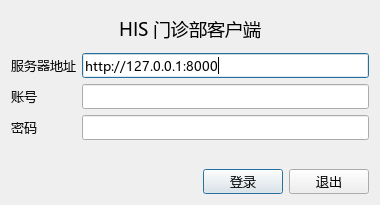
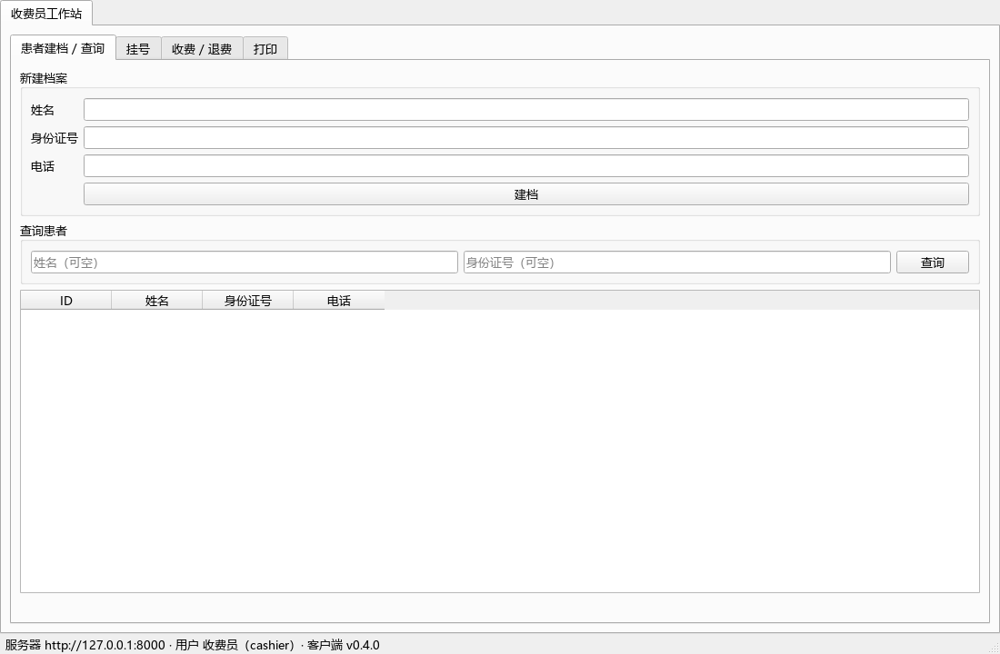
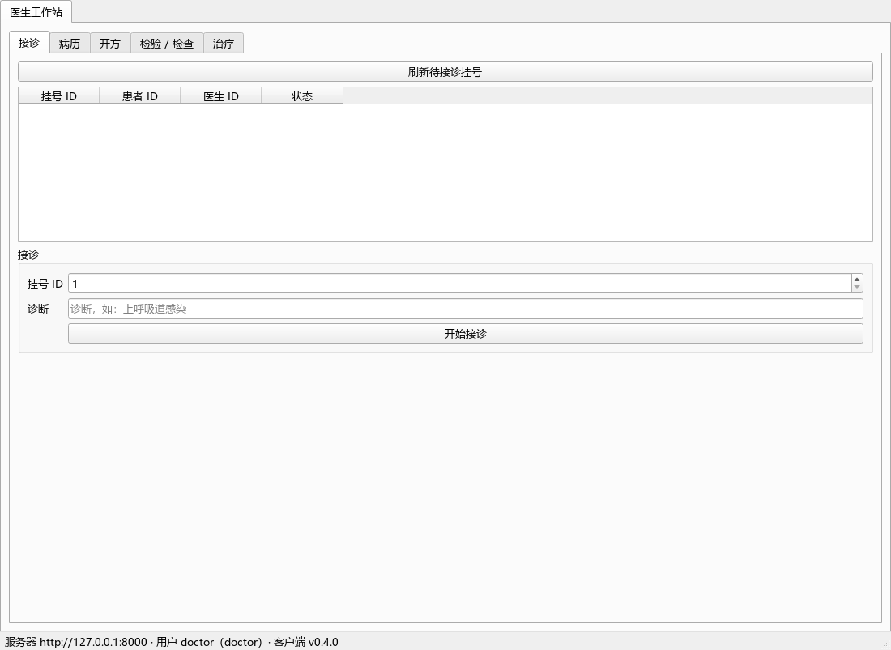
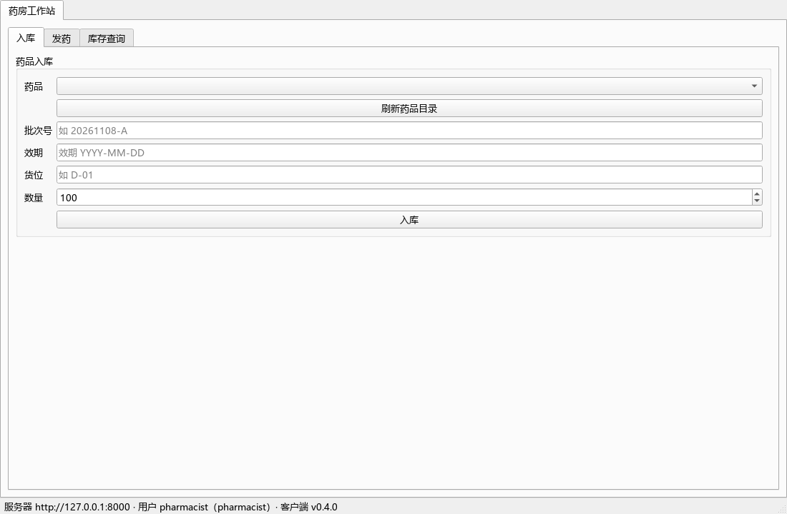
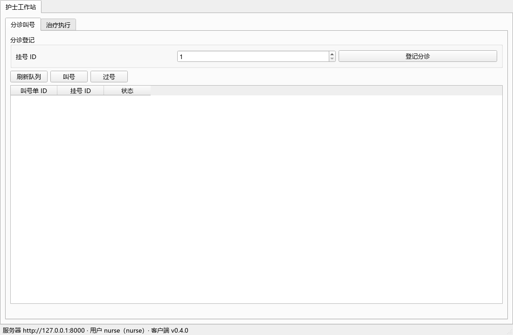

# HIS 门诊部系统

一套可运行、可打包分发的中小型门诊部信息系统：**FastAPI 后端 + Web 管理台 + PySide6 桌面客户端**。

- 后端 30+ 业务模块，覆盖门诊、住院、药房、检验、影像、收费、医保、报表、人事等
- 666 个 pytest 用例，Windows 与 Ubuntu 24.04 均全量通过
- 服务端/客户端均可打包为"绿色包"，拷目录即用，无需安装 Python
- **一个 GitHub 仓库**：`app/` 是服务端，`his_client/` 是桌面客户端；Release 中的 `his-server.zip` / `his-client.zip` 是构建产物，不是两个项目

```text
his-clinic-suite/
├─ app/                 FastAPI 服务端
├─ his_client/          PySide6 桌面客户端
├─ scripts/build_server.bat
├─ scripts/build_client.bat
├─ docs/               部署、流程、测试文档
└─ alembic/             数据库迁移
```

## 部署文档

- [Linux 服务端独立部署](docs/Linux部署指南.md)
- [Android Termux 服务端独立部署](docs/Termux部署指南.md)
- [Windows 桌面客户端部署](docs/客户端部署指南.md)
- [部署文档索引](docs/Linux与Termux部署.md)

## 功能概览

| 部分 | 内容 |
|---|---|
| 后端 | 患者建档、挂号/排班/预约、分诊叫号、接诊、结构化病历（质控/签名）、开方（用法用量）、收费项目与费用明细、**部分退费（全自费可按明细/数量，医保仅整单全额退）**、**支付通道（现金/微信/支付宝/POS/医保卡，可配置）**、医保结算（Mock）、门诊发药/退药、**入库单（收货/验收/入库，药品+器械+耗材+办公）**、**库房两级库存与领用/退库/报损出库（支持部分出库）**、**库存流水台账**、**效期预警与近效期先出**、**药品追溯码扫码**、**医保药品目录（导入/检索/同步/对码校验）**、**医保耗材目录（导入/检索/落地）**、**医保进销存上传（Mock/真实接口配置）**、住院（床位/医嘱/执行/计费/摆药/护理）、检验 LIS、影像 PACS、药库/物资/供应商、临床路径、公卫上报、CA 电子签章、集成平台（FHIR/HL7）、字典、人事考勤薪酬、绩效、BI、财务报表、审计日志 |
| Web 管理台 | 登录、仪表盘、科室/医生/药品/收费项目、用户管理、审计日志、科室收入与处方点评报表 |
| 桌面客户端 | 收费员（**P0 实名建档**：证件类型/可空证件号/性别/生日/患者编号/地址/紧急联系人/医保类型/过敏史/隐私授权，建档前查重、可修改档案；挂号/收费/退费/打印）、医生（**挂号**/接诊/病历/开方/**收费**/检验检查/治疗，工作台显示性别年龄过敏）、**药房工作站**（领用/发药/退药/**收费**/库存/目录/效期/追溯码）、**库房工作站**（入库/出库/总库/效期/追溯码，独立页签）、护士（分诊叫号/患者过敏提醒/治疗执行）、治疗室（处置/耗材/随访，患者过敏提醒）；入库药品/物资下拉默认医保目录；界面状态全部中文显示 |

## 技术栈

Python 3.12 · FastAPI · SQLAlchemy 2 · SQLite（可迁移 PostgreSQL）· Alembic · Jinja2 · PySide6 · PyInstaller · pytest

## 快速开始（源码运行，Windows，不打包 exe）

### 1. 服务端

第一个 PowerShell / CMD 窗口：

```powershell
cd /d D:\Documents\PycharmProjects\HIS
.\.venv\Scripts\python.exe scripts\init_db.py
.\.venv\Scripts\python.exe scripts\seed_demo.py
.\dev_server.bat
```

等价于直接运行：

```powershell
.\.venv\Scripts\python.exe scripts\run_server.py
```

### 2. 桌面客户端

第二个窗口：

```powershell
cd /d D:\Documents\PycharmProjects\HIS
.\dev_client.bat
```

等价于：

```powershell
.\.venv\Scripts\python.exe -m his_client
```

浏览器访问：

- 管理台：<http://127.0.0.1:8001/admin>
- API 文档：<http://127.0.0.1:8001/docs>

> 本机使用 `config.local.ini` 把端口覆盖为 8001；没有 `.venv` 时先执行 `py -3.12 -m venv .venv`，再 `uv sync --extra client`。

### Linux（Ubuntu/Debian）

```bash
uv sync                       # 服务端不需要 PySide6
./start.sh                    # 初始化数据库并启动
```

### 桌面客户端

```powershell
uv sync --extra client
uv run python -m his_client   # 或用 scripts\build_client.bat 打包 exe
```

演示时可直接自动登录（跳过登录框，仅本地演示用）：

```powershell
$env:HIS_CLIENT_USER = "admin"; $env:HIS_CLIENT_PASSWORD = "admin123"
uv run python -m his_client --auto-login
```

## 演示账号

| 账号 | 密码 | 角色 |
|---|---|---|
| admin | admin123 | 管理员（管理台 + 全部工作站） |
| director | director123 | 院长（病案销毁/采购审批） |
| cashier | cashier123 | 收费员 |
| doctor | doctor123 | 医生 |
| pharmacist | pharm123 | 药房（领用申请/发药/退药/库存；医保目录默认隐藏） |
| warehouse | warehouse123 | 库房（入库/验收/出库审核/出库/总库库存） |
| nurse | nurse123 | 护士 |
| lab / radiology | lab123 / rad123 | 检验 / 影像 |

> 演示口令仅供开发试用，生产环境务必修改。

## 界面截图

| 管理台 | 收费员 |
|---|---|
|  |  |

| 医生 | 药房 | 护士 |
|---|---|---|
|  |  |  |

## 下载（整包）

GitHub **Releases** 页面提供两个可直接运行的绿色包（Windows）：

- `his-server.zip`：服务端，解压 → 改 `config.ini` → 双击 `his-server.exe`（首次启动自动建库并创建 `admin/admin123`）
- `his-client.zip`：客户端，解压 → 改 `config.ini` 服务器地址 → 双击 `his-client.exe`
- `his-server-termux-1.1.1.tar.gz`：Termux 专用服务端最小源码包，约 336 KB，不含客户端/测试/视频

源码与构建脚本都在本仓库；数据库 `his.db` 属于运行数据，不入库（用 `seed_demo.py` 可重建演示数据）。

## 目录结构

```
app/                后端（modules/ 下按业务模块组织四件套 models/schemas/service/router）
  modules/admin/    Web 管理台（Jinja2 模板）
alembic/            Alembic 迁移（0001~0089）
his_client/         PySide6 客户端（api/config/ui）
tests/              pytest（666 个用例）
scripts/            初始化、演示、并发检查、打包、服务安装脚本
docs/               部署手册、试用手册、界面截图
config.ini          服务端配置（端口/密钥/数据库）
```

## 验证与演示

```powershell
uv run pytest                                  # 666 passed
uv run python scripts/demo.py                  # 50 步业务断言
uv run python scripts/check_client_flow.py     # 客户端全流程 18 项
uv run python scripts/check_concurrency.py     # 并发抢号验证
```

## 部署文档

- [部署手册总览](docs/部署手册.md)
- [Linux 服务端部署](docs/Linux部署指南.md)
- [Android Termux 服务端部署](docs/Termux部署指南.md)
- [Windows 桌面客户端部署](docs/客户端部署指南.md)
- [部署文档索引](docs/Linux与Termux部署.md)
- [试用手册](docs/小诊所试用手册.md)

## 说明

- 演示用医保/短信/CA 均为本地 Mock，生产接入需替换真实接口与密钥
- 金额、检查检验、医保结算等按演示规则实现，实际使用请按当地政策调整
- 未开源授权，仅供内部评估/演示使用
