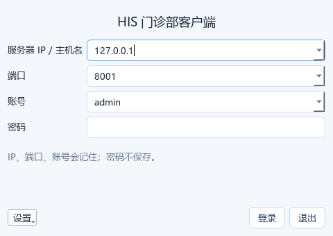

# 主题手动刷新

## 为什么改成手动

Windows/Qt 的 `colorSchemeChanged` 在不同版本、远程桌面、高对比度设置下并不总是可靠触发。

自动监听还带来过两个问题：

- 登录窗口没有重新套用窗口 QSS
- `setPalette()` 触发 `ApplicationPaletteChange`，再次进入刷新，造成重入卡死

因此不再自动跟随，改为显式刷新：

```text
设置 → 刷新主题
```

## 入口

### 主窗口

菜单：

```text
设置
├─ 刷新主题   F12
└─ 退出
```

### 登录窗口

登录框左下角：

```text
[设置 ▼]   [登录] [退出]
```

菜单里同样有“刷新主题”。



## 刷新时做什么

1. 读取 Windows 当前应用主题：

```text
HKEY_CURRENT_USER\Software\Microsoft\Windows\CurrentVersion\Themes\Personalize
AppsUseLightTheme
```

2. 非 Windows 或读取失败时，回退到 Qt `colorScheme()` / 调色板亮度

3. 重新应用：

- 全局 QSS
- QApplication 调色板
- MainWindow 的旧 QSS 清理
- 登录窗口 QSS
- 患者条、患者卡、侧栏页签、危急值标记、出生日期年龄控件

4. 通过 Windows DWM 重新设置标题栏/窗口边框颜色（Windows 10 用旧属性，Windows 11 用新属性）
5. 不重建窗口，不丢失表单内容，不打断当前患者

## 为什么手动更稳

- 不依赖系统信号
- 没有定时器
- 没有事件重入
- 用户明确知道什么时候刷新
- 切换系统主题后点一次即可

## 强制主题

```powershell
$env:HIS_THEME = "light"
$env:HIS_THEME = "dark"
```

设置后刷新仍使用强制主题。

## 语义色

过敏、危急值、错误、警告等颜色仍保持语义色，不随深浅色反转。

## 验证

```text
启动客户端
Windows 设置 → 个性化 → 颜色 → 切换浅色/深色
客户端菜单 → 设置 → 刷新主题
```

应看到：

- 登录框同步刷新
- 主窗口同步刷新
- 不卡死
- 表单内容不丢
