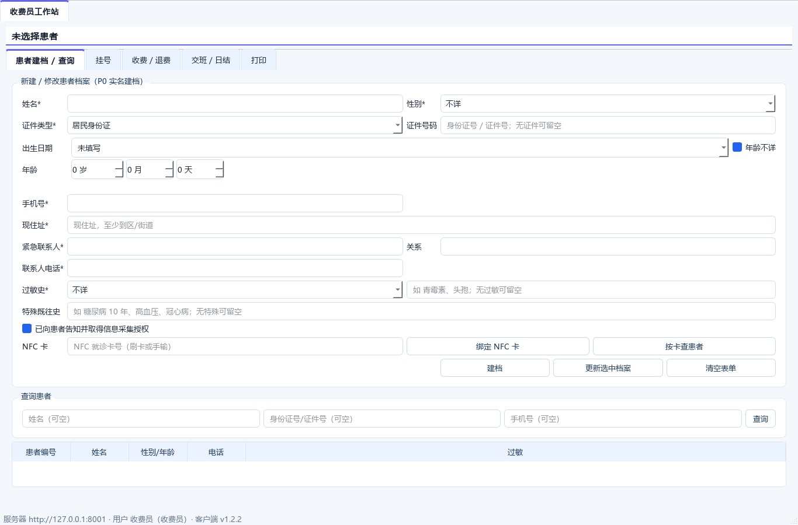
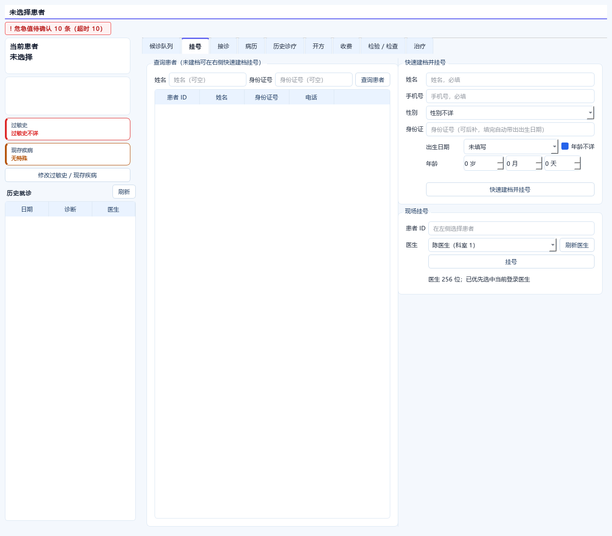

# 出生日期 / 年龄 / 身份证联动

## 一、先评估：这个设计是否合理

合理，而且比单独一个“年龄”输入框更符合门诊建档。

### 为什么不只用年龄

年龄会随时间变化，出生日期不会。

- 出生日期是**权威值**
- 年龄是**派生值**
- 身份证是**出生日期的来源之一**

所以正确关系是：

```text
身份证号 ──提取──> 出生日期 ──计算──> 年龄（年/月/日）
                         ↑
年龄（年/月/日） ──反推──┘   （仅在没有身份证/生日时使用，属于近似）
```

### 为什么年龄要显示年月日

儿童、婴儿、新生儿场景只用“几岁”不够：

```text
3 岁
3 岁 2 个月
3 岁 2 个月 5 天
```

门诊处方、疫苗、儿科判断都更依赖精确月龄。

### 为什么要有“年龄不详”

现实中存在：

- 无证件、无名氏
- 患者/家属说不清生日
- 急救先建档后补

强制填生日会逼用户编一个假日期，反而污染数据。所以“年龄不详”必须是独立选项，而不是用 0 岁代替。

## 二、实现方式

新增可复用控件：

```text
his_client/ui/birth_age.py
```

### 界面

```text
出生日期  [yyyy-MM-dd ▼]  [ ] 年龄不详
年龄      [ 0 岁 ] [ 0 月 ] [ 0 天 ]   35岁2个月3天

身份证号  [____________________]
```

- 出生日期使用 `QDateEdit`
- 带日历弹窗
- 年龄使用年/月/日三个 `QSpinBox`
- 年龄不详勾选后，日期和年龄输入禁用
- 默认就是“年龄不详”，不会默认 1 岁

### 联动规则

#### 身份证 → 出生日期 → 年龄

支持：

- 18 位身份证
- 15 位老身份证

18 位会校验：

- 前 17 位数字
- 出生日期合法
- 校验位

校验位错误时仍提取出生日期，但明确提示“请核对”，不静默放行。

#### 出生日期 → 年龄

按今天计算：

```text
周岁 / 月 / 日
```

例如：

```text
出生：2000-01-02
今天：2026-11-14
年龄：26岁10个月12天
```

#### 年龄 → 出生日期

按“今天减去年/月/日”反推。

会提示：

```text
年龄反推的出生日期为近似值；有身份证时以身份证为准
```

原因：

- 只知道“3 岁”无法知道具体生日
- 反推只能得到近似日期
- 一旦录入身份证，以身份证为准

### 年龄不详

勾选后：

- `birth_date = null`
- 保存时允许为空
- 患者表显示“年龄不详”
- 不会写入 0 岁或 1 岁

## 三、放在哪些页面

### 收费员：患者建档

- 身份证号
- 出生日期（日历）
- 年龄（年/月/日）
- 年龄不详

### 医生：快速建档并挂号

同样一套控件，避免收费端和医生端行为不一致。

### 患者列表

患者列表的“性别/年龄”列：

- 有出生日期：显示精确年龄，如 `女/35岁2个月3天`
- 无出生日期：显示 `年龄不详`

### 患者详情/挂号标签

同步显示精确年龄或“年龄不详”。

## 四、admin 身份怎么处理

不建议把 `admin` 直接做成一个叫“管理员”的医生记录。

原因：

- 会出现在医生排班、挂号医生列表
- 病历/处方会归属到“管理员医生”
- 统计会把管理账号算成临床医生
- 真实医生与系统管理员职责不同

当前设计：

```text
admin
  = 系统管理员
  = 默认拥有所有工作站入口
  = 可以进入医生站
  ≠ 自动成为一个临床医生
```

如果管理员本人确实出诊，正确做法是：

1. 建立真实医生档案
2. 用医生账号登录
3. 或把管理员账号与医生档案建立关联（后续可做 `users.doctor_id`）

这样既保留“管理员拥有所有工作站”的便利，又不污染临床数据。

## 五、截图





## 六、验证

- 18 位身份证提取出生日期
- 15 位老身份证提取出生日期
- 校验位错误提示
- 出生日期 → 精确年龄
- 年龄 → 近似出生日期
- 年龄不详 → `birth_date = null`
- 收费端/医生端共用同一个控件

## 七、边界

- 年龄是动态值，每次打开页面按当天计算，不落库
- 出生日期是唯一落库值
- 年龄反推只用于没有身份证/生日的场景
- 患者身份证信息属于敏感信息，界面不写入日志
