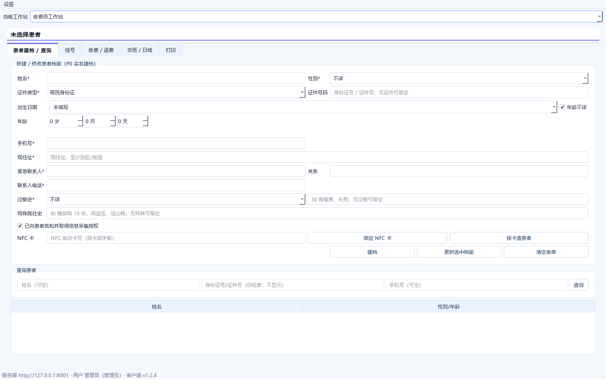
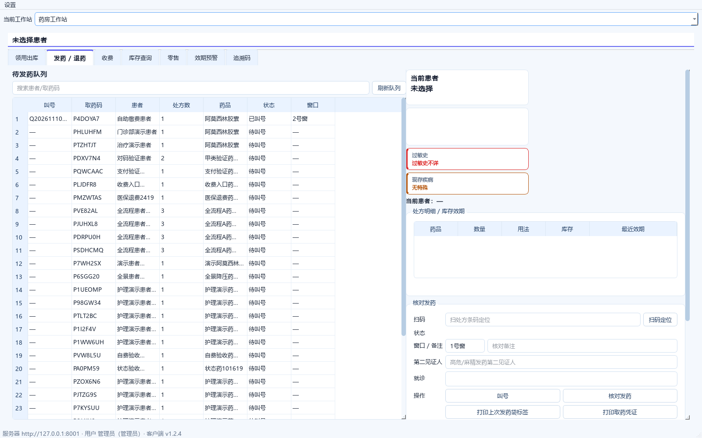
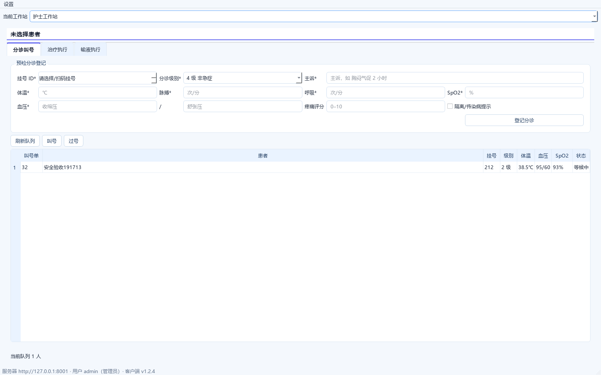
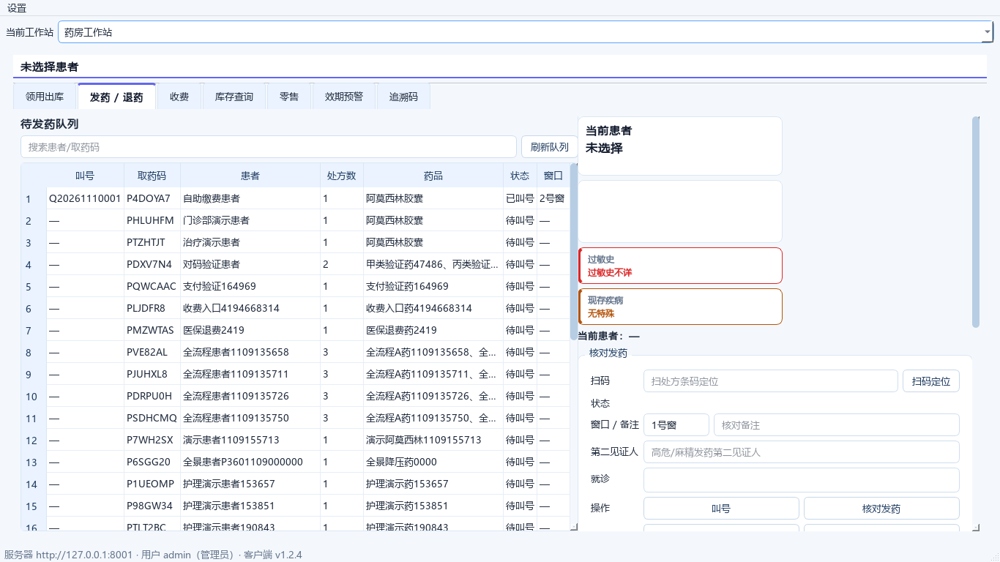
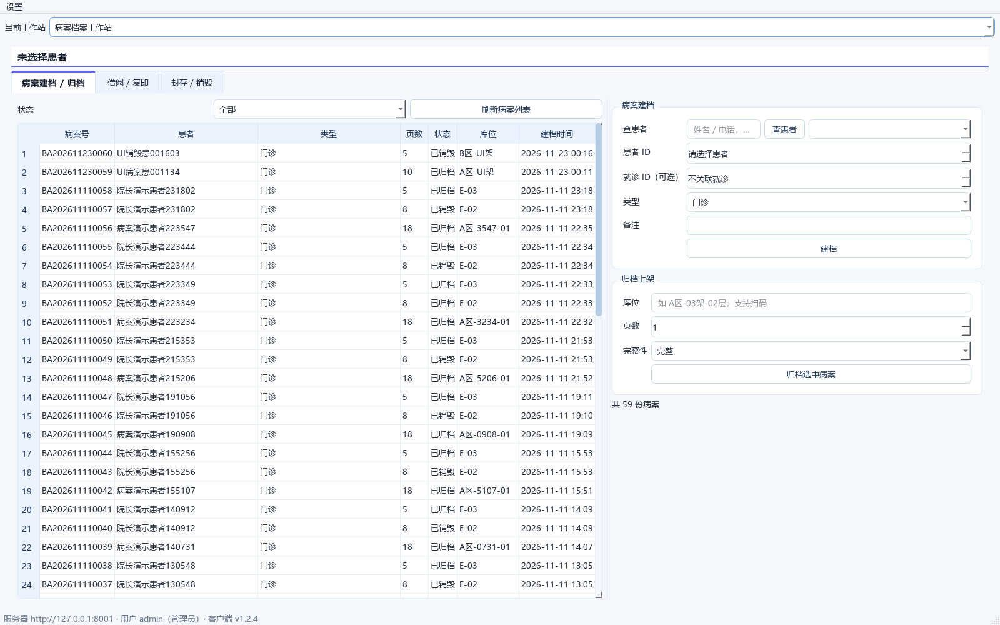
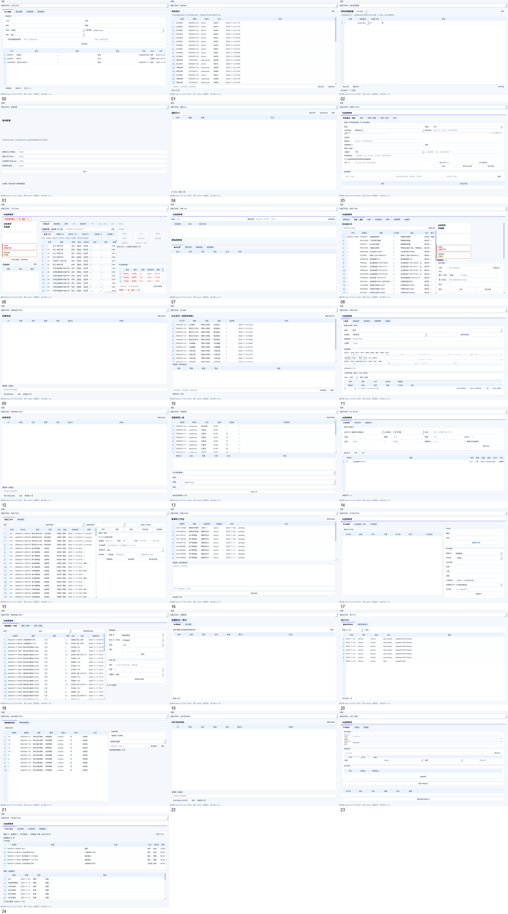
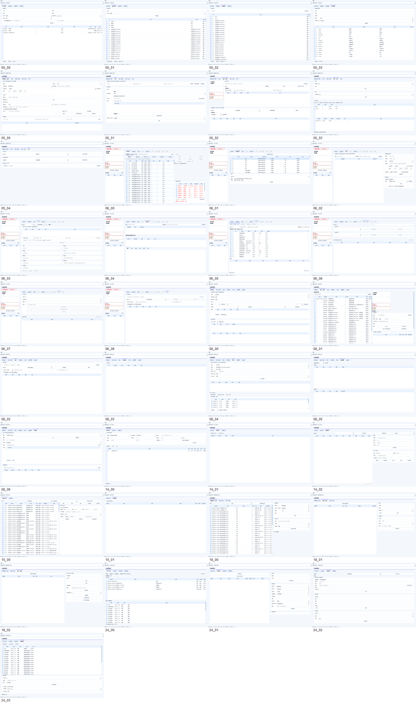

# 前端逐模块审计与取舍

- 日期：2026-11-23
- 范围：`his_client/ui` 全部 40 个 UI 文件、96 个页签（含嵌套）、25 个管理工作站
- 依据：`docs/客户端布局审计.md`、`docs/全窗口UI审计.md`、`docs/子系统布局参考.md`、NHC 门诊/电子病历/智慧服务条款、OpenHIS/上海 HIS 行为参考
- 方法：代码盘点 + 实际打开 1600×1000 界面截图 + 1366×768 最低窗口约束检查 + 任务流走查
- 原则：参考布局和操作顺序，不复制厂商图标、配色或代码；高风险操作优先安全，低价值装饰不硬改

## 一、总览

本轮先解决“看不见、点错、挤在一起”三类问题，而不是只换皮肤。

已实施：

1. 管理员 25 个工作站由横向溢出页签改为下拉工作站选择，全部入口可见；
2. 药房工作站默认进入“发药 / 退药”，不再默认停在“领用出库”；
3. 药房右侧核对区改为可滚动、操作按钮分两行、分栏比例调整，解决重叠/裁切；
4. 护士分诊挂号 ID 默认空值，录入后自动加载患者姓名/患者号/过敏，队列新增患者列；
5. 治疗、人事、检验、病案、药房表格统一为“关键列拉伸、其余内容宽”，最后一列不再吞空间；
6. 收费、病案、退药、中药、治疗等关键 ID 默认空值，提交前校验，降低误操作；
7. 打印预览移除“浏览器打开”绕过凭据入口，统一带 Basic 预览；
8. 患者访问/操作审计补 IP，前端患者上下文可见性由后端字段支撑；
9. 护士队列返回患者姓名/患者号，分诊登记选行自动回填；
10. 病历签名后锁诊断/处方（后端），前端不再允许签名后继续开方；
11. 收费、病案、退药、中药、治疗、手术等关键 ID 去除默认 1，空值 + 提交校验；
12. 新增患者搜索选择器 `PatientPicker`，接入病案、治疗室、手术室；收费面板进一步接入“选患者 → 列出就诊 → 选就诊 → 收费”。

实际截图：















> 门诊工作站的逐页签专项重构见 [门诊工作站重构](门诊工作站重构.md)。

## 二、逐工作站结论

| 工作站 / 页面 | 显示内容 | 操作逻辑 | 布局 | 结论 |
|---|---|---|---|---|
| 登录 | 服务器、账号、密码、记忆配置 | 单任务登录，密码不保存 | 460px 单列，字段顺序清楚 | 保留；不把工作站导航塞进登录页 |
| 主窗口 | 当前工作站、患者条、状态栏 | 角色决定工作站，管理员可切换 | 25 个管理站改为下拉；普通角色保留页签 | **已改**；管理员不再横向溢出 |
| 收费员-建档/查询 | 实名字段、NFC、患者列表 | 建档/更新/清空/按卡查询 | 表单两列，查询结果独立 | 保留；后续可折叠低频联系方式 |
| 收费员-挂号 | 患者、医生、号源 | 选患者后挂号 | 单列表单 + 列表 | 保留；初诊/复诊已有 |
| 收费员-收费/退费 | 费用明细、收款方式、退费明细 | 收费后打印，按明细退费 | 左费用右操作 | 保留；退费 ID 已去除默认 1 风险 |
| 收费员-交班/日结 | 渠道汇总、差异 | 开班/交班/日结 | 表格优先 | 保留 |
| 医生-门诊队列 | 患者、类型、医生、状态、待缴 | 双击/开始接诊 | 三栏：上下文/队列/动作 | 保留；患者列优先于 ID |
| 医生-接诊登记 | 患者、挂号、分诊信息 | 开始接诊、继续接诊 | 左患者条 + 右表单 | 保留；未接诊前动作禁用 |
| 医生-病历 | 诊断 + 9 个病历字段 | 保存/签名，诊断置顶 | 两列网格 | 保留；签名锁/收费锁仍待后端专项 |
| 医生-开方 | 药品目录、处方明细、用法 | 目录检索 → 加明细 → 提交 | 左右分栏 | 保留；常用用法靠右 |
| 医生-检验/检查 | 申请、结果、危急值 | 开单、查看结果、确认危急值 | 左申请右结果/提醒 | 保留；危急值独立红色区 |
| 医生-治疗 | 项目、明细 | 开治疗单 | 左右分栏 | 保留 |
| 药房-发药/退药 | 待发队列、患者、处方明细、库存效期、见证人 | 选队列 → 核对 → 发药/部分退药 | 左队列右滚动核对区 | **已改**：默认发药，右栏不再重叠 |
| 药房-领用出库 | 申请类型、目标、明细 | 向库房申请 | 单列表单 + 明细 | 保留给药房，但不再作为默认页 |
| 药房-收费 | 复用收费面板 | 收费 | 嵌入面板 | 保留 |
| 药房-库存/效期/追溯 | 库存、批次、效期、码 | 查询、扫码 | 表格 + 筛选 | 保留；列宽按内容 |
| 药房-零售 | 非处方药/耗材、购物明细 | 加购、收款、退货 | 表单 + 明细 | 保留 |
| 库房-入库/出库/总库 | 单据、验收、批次、状态 | 收货→验收→入库/出库 | 左单据右处理 | 保留；后续补强采购到货事务 |
| 护士-分诊叫号 | 患者姓名、挂号、级别、生命体征、状态 | 选患者→分诊→叫号/过号 | 顶部登记 + 下方队列 | **已改**：显示患者姓名，默认空 ID，选行回填 |
| 护士-治疗执行 | 待执行治疗、配药、执行/巡视 | 核对→执行→完成 | 左执行单右操作 | 保留；高危药第二核对已有 |
| 护士-输液执行 | 输液单、滴速、巡视 | 配药/开始/巡视/完成 | 左列表右记录 | 保留 |
| 检验-工作台 | 申请、标本、患者、项目、状态、结果 | 采样/签收/拒收/开始/报告 | 左工作列表右结果审核 | 保留；表格列已收口 |
| 检验-报告查询 | 报告号、患者、项目、结果、审核 | 查询/查看 | 单表 + 详情 | 保留 |
| 影像-工作台 | 申请、患者、项目、状态 | 登记/报告 | 左列表右报告 | 保留；结构化报告仍待后端 |
| 手术-排班/核查/复苏 | 手术间、排班、三方核查、麻醉 | 排班→核查→术中→复苏 | 三页签 + 表单 | 保留；三方同时签名仍待做 |
| 治疗室-今日工作台 | 候诊、处置中、待收费、随访 | 选病例→开始/完成 | 上下双表 | 保留；列宽已修 |
| 治疗室-排队/记录/随访 | 处置、知情同意、模板、耗材 | 新建→同意→开始→完成→随访 | 左队列右详情 | 保留；患者条常驻 |
| 病案-建档/归档 | 病案号、患者、类型、库位 | 建档→归档→上架 | 左列表右表单 | 保留；患者 ID 默认空值 |
| 病案-借阅/复印 | 借阅、应还、复印内容 | 借出/归还/登记复印 | 左列表右操作 | 保留；逾期提醒可见 |
| 病案-封存/销毁 | 封存、启封、销毁申请 | 申请→院长审批→双人执行 | 左列表右表单 | 保留；直接销毁已由后端阻断 |
| 院长-病案销毁 | 申请、病案、原因、附件、状态 | 选申请→意见模板→批准/驳回 | 左列表右详情 | 保留；附件预览仍待做 |
| 院长-采购审批 | 采购单、金额、明细 | 批准/驳回 | 左列表右详情 | 保留 |
| 患者360 | 就诊、预约、病案、收费 | 查询患者→四页签 | 顶部患者条 + 页签 | 保留 |
| 中药-开方/中药房/煎药 | 饮片、处方、煎药过程 | 开方→审核→浸泡→煎煮→包装→发放 | 左目录右处方/过程 | 保留 |
| 人事 | 员工、医生、科室、账号 | 新增/离职/停用/建账号 | 顶部表单 + 表格 | 保留；表格列已收口 |
| 麻精账册 | 专用账册、盘点差异 | 发药/退回/盘点/审批 | 两页签 + 表格 | 保留 |
| 审计中心 | 患者访问、病历版本 | 查询/追溯 | 双表 | 保留 |
| 审批待办/流程 | 待办、步骤、转交、撤回 | 审批/驳回/转交 | 列表 + 详情 | 保留；超时升级调度仍待做 |
| 通知中心 | 通知、已读、派发 | 查看/派发 | 单表 | 保留 |
| 集成配置 | 接口地址、开关 | 保存/测试 | 单列表单 | 保留；外部系统仍是配置态 |
| 采购到货 | 采购单、收货、验收 | 收货→验收→入库 | 左单右明细 | 保留；与采购申请事务仍待补 |
| 处方审方/药事审核/治疗审批 | 待审列表、明细、意见 | 通过/驳回 | 列表 + 详情 | 保留 |

## 三、逐 UI 文件清单与取舍

| 文件 | 结论 | 说明 |
|---|---|---|
| `main_window.py` | 已改 | 管理端 25 站下拉；普通角色保留页签；`self.tabs` 供自检 |
| `sidebar_tabs.py` | 保留 | 懒加载、错误页、页签滚动；管理端溢出由主窗口下拉解决 |
| `login.py` | 保留 | 单任务、字段少、密码不记忆 |
| `theme.py` / `window_theme.py` | 保留 | 浅色/深色统一主题，不重复造配色 |
| `patient_banner.py` | 保留 | 患者姓名/性别年龄/过敏/就诊/状态 |
| `patient_info_panel.py` | 保留 | 药房/治疗室患者上下文；空白高度后续可压缩 |
| `table_policy.py` | 已改 | 新增 `set_column_layout`，关键列拉伸、其余内容宽 |
| `cashier.py` | 部分改 | 退费/收费 ID 安全化；表单仍保持完整实名字段 |
| `doctor.py` | 保留 | 三栏、患者条、按任务禁用；签名/收费死锁属后端专项 |
| `pharmacy.py` | 已改 | 默认发药、右栏滚动、操作分两行、表格列宽、见证人 |
| `nurse.py` | 已改 | 患者姓名入队、默认空 ID、录入回填患者条 |
| `lab.py` | 已改 | 工作台/报告表列宽；结果区保持独立 |
| `radiology.py` | 保留 | 单表 + 报告详情；结构化模板待后端 |
| `surgery.py` | 保留 | 排班/核查/复苏三页签；三方签名待后端 |
| `treatment_room.py` | 已改 | 今日工作台/治疗排队列宽；患者/处置 ID 安全化 |
| `archive.py` | 已改 | 患者 ID 空值；三表列宽；条码/库位仍可继续强化 |
| `director.py` | 保留 | 左申请右详情，意见模板已具备 |
| `patient360.py` | 保留 | 四页签聚合，一屏完成查询 |
| `tcm.py` | 部分改 | 就诊 ID 空值；开方/煎药流程保持 |
| `hr.py` | 已改 | 四表列宽；新增员工表单保持 |
| `narcotic.py` | 保留 | 账册/盘点两页签 |
| `audit_center.py` | 保留 | 双表审计 |
| `notifications.py` | 保留 | 单表 + 已读/派发 |
| `approval_inbox.py` / `approval_flow.py` | 保留 | 列表 + 流程详情；超时升级调度待后端 |
| `catalog_proposal.py` | 保留 | 审核列表 + 详情 |
| `prescription_review.py` | 保留 | 双表审方 |
| `purchase_receive.py` | 保留 | 采购到货两表 |
| `payment.py` | 已改 | 就诊 ID 空值；收费面板共用 |
| `prescription_edit.py` / `prescription_dialog.py` | 保留 | 编辑/选择弹窗，低风险 |
| `mixed_payment_dialog.py` | 保留 | 混合支付弹窗，校验合计 |
| `adverse_reaction_dialog.py` | 保留 | 高风险确认弹窗 |
| `diagnosis_editor.py` | 保留 | 诊断排序/主诊断 |
| `print_preview.py` | 已改 | 带 Basic 预览，移除浏览器绕过 |
| `birth_age.py` | 保留 | 出生日期/年龄联动工具 |
| `integration_config.py` | 保留 | 配置页，单任务 |

## 四、明确不优化的理由

- **登录页不做工作站导航**：登录是单任务；加入导航会增加误触和密码暴露面。
- **高风险确认仍用弹窗**：销毁、退费、作废、混合支付、药物反应需要阻断式确认，不能改成无感操作。
- **表格不做全量分页/虚拟化**：当前接口多数没有分页参数；强行前端分页会隐藏数据。已在关键表用列宽/滚动/状态筛选，分页需后端配套。
- **不复制参考工程配色/图标**：只借鉴主从布局、状态驱动、患者条、固定操作区；视觉保持本项目浅色主题。
- **不把每个 ID 都改成下拉搜索**：涉及后端新查询接口的工作站（病案、治疗、手术）先去除危险默认值；患者搜索选择器列入下一批，不半成品上线。

## 五、验证与剩余

实际验证：

```text
768 passed（本轮 UI 改造后全量）
Alembic 0102 (head)
SELF-TEST OK tabs=25 widgets=5
```

已复核 1600×1000 与 1366×768 全部 25 个顶层工作站：管理员下拉、药房首屏主按钮、护士患者列在两种尺寸下均可见；药房明细/签名区在 768 高时滚动。另抽查 37 个嵌套页签（收费 5、医生 9、药房 7、护士 3、检验 2、病案 3、治疗 4、人事 4），未发现新的重叠/裁切。

剩余前端 P0/P1：

- 收费/病案/治疗/手术的“患者姓名/卡号搜索选择器”，替代纯 ID 输入；
- 医生病历签名后仍可改诊断/开方的后端锁；
- 药房右侧患者信息面板压缩、发药后自动清空；
- 检验结果趋势/历史对比；
- 手术三方同时签名；
- 管理端工作站分组（下拉已解决溢出，后续可按门诊/药事/医技/管理分组）；
- 表格列宽持久化到 `ui_state.ini`；
- 1366×768 全部顶层工作站 + 37 个嵌套页签已抽查；剩余嵌套页签继续按附录复核。

## 附录：39 个原有 UI 文件 + 患者选择器 / 96 个页签盘点

> 本表由源码自动提取，确保没有漏文件；状态列表示本轮深度检查/改造重点，未标“已改”的页签仍纳入布局与操作基线检查，后续按 P1 继续。

| 文件 | 页签 | 本轮 |
|---|---|---|
| adverse_reaction_dialog.py | — | 工具/弹窗 |
| approval_flow.py | — | 工具/弹窗 |
| approval_inbox.py | — | 工具/弹窗 |
| archive.py | 病案建档 / 归档, 借阅 / 复印, 封存 / 销毁 | 已改 |
| audit_center.py | 患者访问审计, 病历修改版本 | 已看/保留 |
| birth_age.py | — | 工具/弹窗 |
| cashier.py | 患者建档 / 查询, 挂号, 收费 / 退费, 交班 / 日结, 打印 | 已改 |
| catalog_proposal.py | — | 工具/弹窗 |
| diagnosis_editor.py | — | 工具/弹窗 |
| director.py | 病案销毁审批, 采购申请审批 | 已看/保留 |
| doctor.py | 门诊队列, 接诊登记, 挂号, 病历, 历史诊疗, 开方, 检验 / 检查, 治疗, 收费, 病历, 处方, 检验, 治疗, 收费, 支付, 西药 / 中成药 / 注射, 中药饮片, 中药注射, 处方中心 | 已看/保留 |
| hr.py | 员工档案, 医生管理, 科室管理, 账号管理 | 已改 |
| integration_config.py | — | 工具/弹窗 |
| lab.py | 检验工作台, 报告查询 | 已改 |
| login.py | — | 工具/弹窗 |
| main_window.py | 人事工作站, 审批待办, 审批流程配置, 集成配置, 通知中心, 收费员工作站, 门诊工作站, 患者 360, 药房工作站, 药事审核工作站, 处方审方, 库房工作站, 库房审核工作站, 采购到货, 护士工作站, 检验工作站, 影像工作站, 手术室工作站, 病案档案工作站, 麻精账册, 审计中心, 院长审批工作站, 治疗项目审批, 中药处方, 中药房 / 煎药室, 煎药室, 中药 / 煎药, 治疗室工作站, 审批待办 | 已改 |
| mixed_payment_dialog.py | — | 工具/弹窗 |
| narcotic.py | 专用账册, 盘点差异 | 已看/保留 |
| notifications.py | — | 工具/弹窗 |
| nurse.py | 分诊叫号, 治疗执行, 输液执行 | 已改 |
| patient360.py | 就诊记录, 预约记录, 病案档案, 收费明细 | 已看/保留 |
| patient_banner.py | — | 工具/弹窗 |
| patient_clinical_dialog.py | — | 工具/弹窗 |
| patient_info_panel.py | — | 工具/弹窗 |
| payment.py | — | 已改 |
| pharmacy.py | 入库单, 出库处理, 总库库存, 领用出库, 发药 / 退药, 收费, 库存查询, 零售, 医保目录, 效期预警, 追溯码 | 已改 |
| prescription_dialog.py | — | 工具/弹窗 |
| prescription_edit.py | — | 工具/弹窗 |
| prescription_review.py | — | 工具/弹窗 |
| print_preview.py | — | 已改 |
| purchase_receive.py | — | 工具/弹窗 |
| radiology.py | — | 工具/弹窗 |
| sidebar_tabs.py | — | 工具/弹窗 |
| surgery.py | 手术排班, 安全核查 / 术中, 术后复苏 | 已改 |
| table_policy.py | — | 已改 |
| tcm.py | 开中药方, 中药房, 煎药室 | 已改 |
| theme.py | — | 工具/弹窗 |
| treatment_room.py | 今日工作台, 治疗排队, 处置记录, 换药随访 | 已改 |
| window_theme.py | — | 工具/弹窗 |

合计：39 个原有文件 + 1 个新增患者选择器、96 个页签；管理员 25 个工作站另见 `docs/frontend_tour/` 截图。