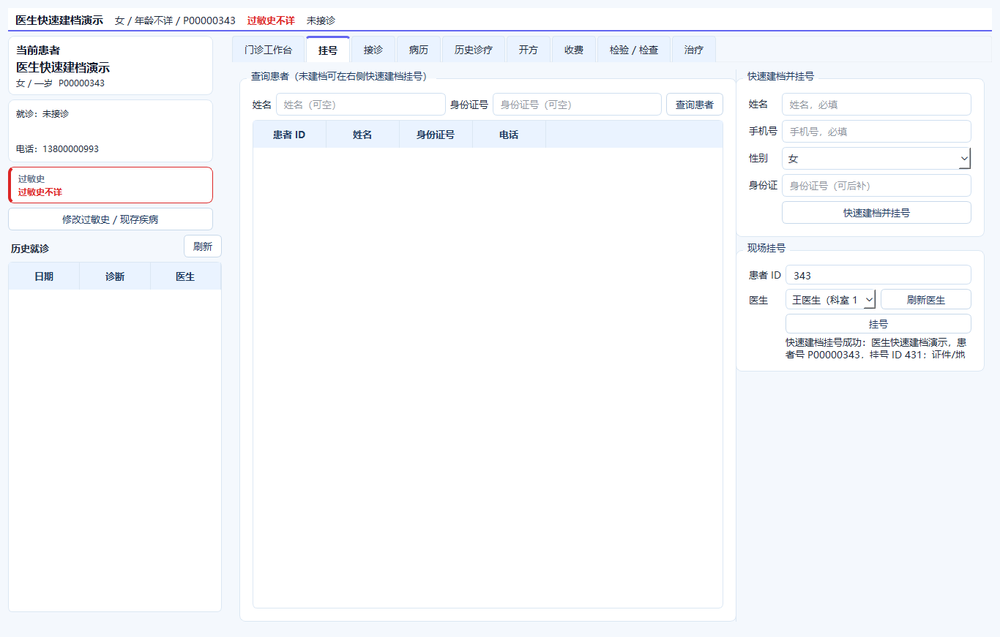

# 门诊医生快速建档挂号

## 入口

门诊工作站 → 挂号 → 右侧“快速建档并挂号”

## 字段

- 姓名（必填）
- 手机号（必填）
- 性别
- 身份证号（可后补）

## 行为

- 医生角色可直接创建患者档案
- 创建后立即生成挂号记录
- 患者号自动生成
- 证件号/地址/紧急联系人可后补
- 默认自费、过敏史不详、隐私同意
- 创建后刷新待接诊队列

## 权限

`POST /patients/` 允许 `cashier`、`doctor`；管理员继续保留全权限。

`GET /patients/duplicates` 允许 `cashier`、`doctor`。

## 边界

- 快速建档只收最小字段，后续可在收费员建档页补全
- 已有身份证号会复用原患者，不重复建档
- 医生仍可选择其他医生挂号

## 界面

