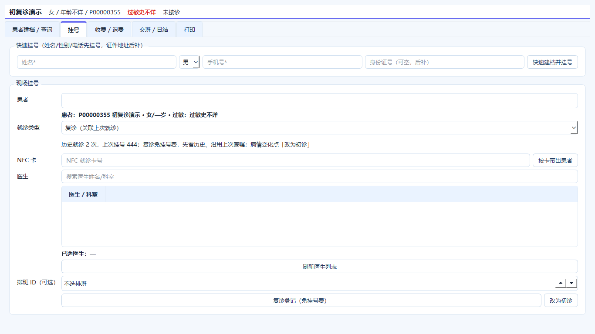
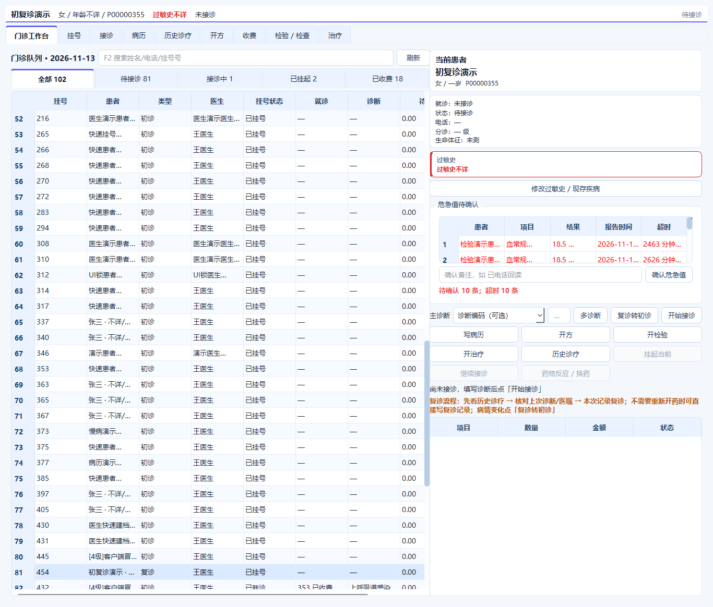

# 复诊流程（免挂号费，保留记录）

## 一句话

**复诊不是不记录，而是免挂号费、保留复诊记录、先看历史、延续上次医嘱；病情变化转初诊。**

## 收费员

选中患者后系统按历史自动判断：

- 无历史 → 初诊
- 有历史 → 复诊

界面：

```text
就诊类型 [复诊（关联上次就诊）]
历史就诊 2 次，上次挂号 444；
复诊免挂号费，先看历史、沿用上次医嘱；病情变化点「改为初诊」

[复诊登记（免挂号费）] [改为初诊]
```

- 复诊：跳过挂号费，仍生成复诊挂号/就诊记录
- 初诊：正常收挂号费
- 已生成复诊记录但尚未接诊，可点“改为初诊”
- 已接诊后不能改挂号类型

## 医生站

复诊患者顶部提示：

```text
复诊流程：先看历史诊疗 → 核对上次诊断/医嘱 → 本次记录复诊；
不需要重新开药时可直接写复诊记录；病情变化点「复诊转初诊」
```

- “历史诊疗”查看上次诊断、处方、检验、治疗
- 不需要重新开药时，只写本次复诊记录即可
- 病情变化且尚未接诊：点“复诊转初诊”，按初诊收挂号费
- 已接诊后不能转类型

## 费用

| 项目 | 初诊 | 复诊 |
|---|---|---|
| 挂号费 | 收 | **不收** |
| 诊疗费 | 收 | 收 |
| 药品/检验/治疗 | 按实际 | 按实际 |

复诊记录仍需收费关闭，不能因为免挂号费就不留记录。

## 看化验结果怎么操作

### 当天出结果

1. 医生接诊、写初步诊断、开检验
2. 患者离开前，点 **“挂起当前”**
3. 检验科采样、报告
4. 患者回来，医生在门诊工作台选 **“全部”** 或 **“已挂起”**
5. 选中同一患者，点 **“继续接诊”**
6. 到 **“检验/检查”** 查看结果
7. 更新诊断、开药/治疗，收费关闭

**不要重新挂号**，同一就诊记录继续用。

### 第二天出结果

未完成（进行中/已挂起）的就诊会保留在门诊队列 14 天，并显示跨日日期：

```text
就诊
11-12 365 已挂起
```

选 **“继续接诊”** 即可，不需要新挂号。

### 如果已经收费关闭

原就诊不能再改。需要重新评估时：

- 挂 **复诊号**（免挂号费，关联上次就诊）
- 查看历史结果
- 需要新检查/新处方时在新就诊里开

### 当前不足

- 没有“待结果”专用状态，暂用“已挂起”
- 普通化验结果没有自动回诊提醒，只有危急值提醒
- 医生需主动到“检验/检查”或“历史诊疗”看结果
- 不自动复制上次处方/治疗，医生看历史后手动处理

## 与治疗复诊的区别

- **医生复诊**：需要门诊病历/诊断，走复诊挂号，免挂号费
- **治疗复诊**：同一治疗方案继续做（换药、拆线、输液、理疗），治疗室“按上次治疗复诊”，不新建挂号/就诊，只收治疗费

## 限制

- 复诊自动免挂号费，不做“3 天/7 天窗口”限制
- 不自动复制上次处方，医生看历史后决定是否沿用
- 已接诊后不能把复诊改成初诊
- 复诊没有单独统计报表

## 代码

- `registrations.visit_type = follow_up`
- `registrations.original_registration_id`
- `encounters.visit_type = follow_up`
- `encounters.original_encounter_id`
- 复诊接诊跳过 `REG` 挂号费，保留 `CONSULT` 诊疗费
- `PUT /registrations/{id}/visit-type` 接诊前转换类型


## 界面




