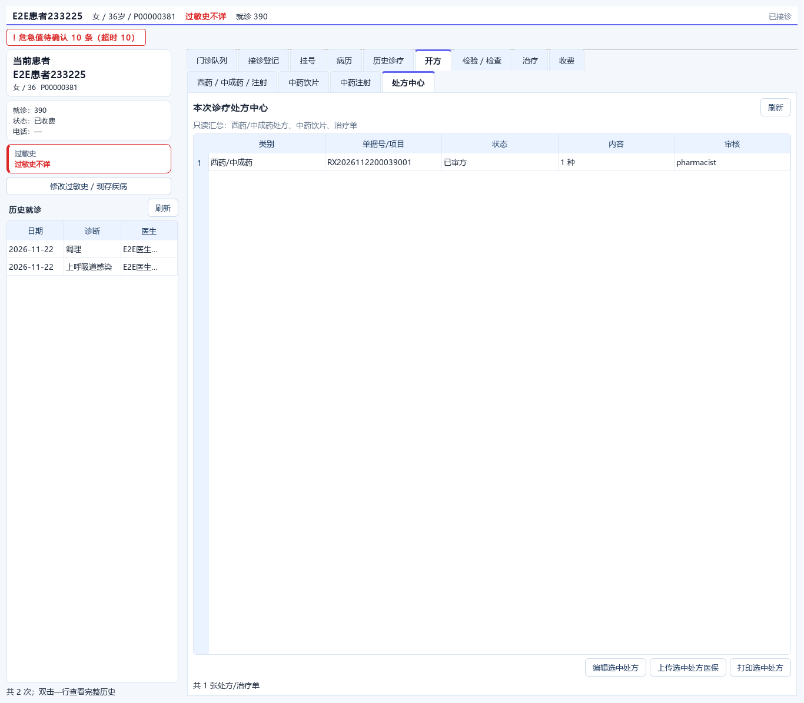
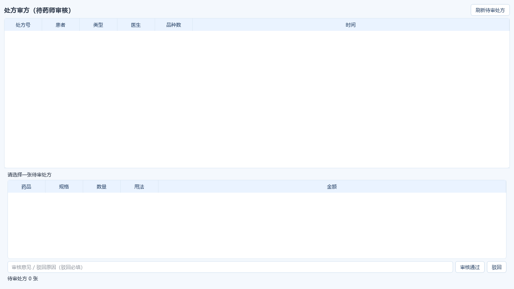
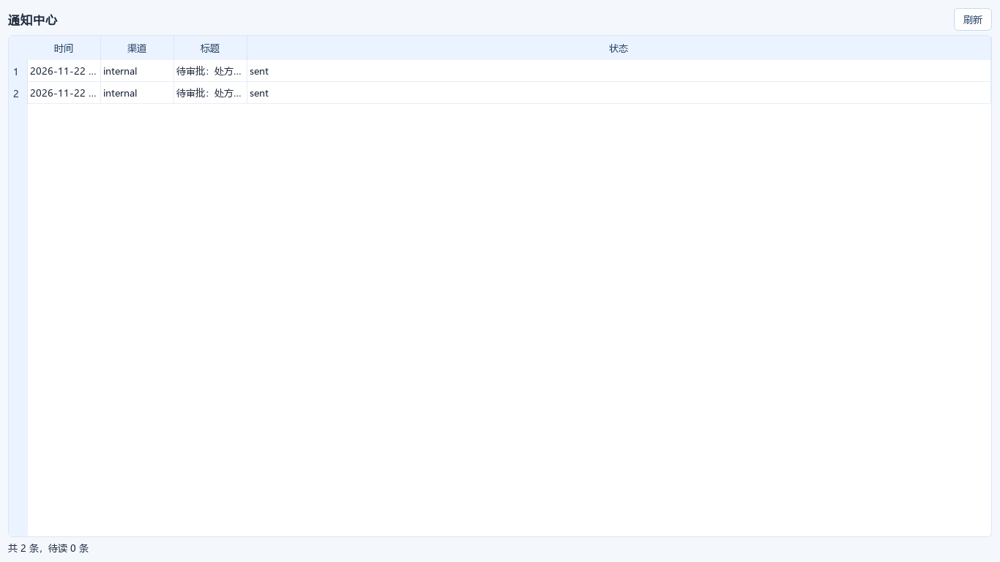
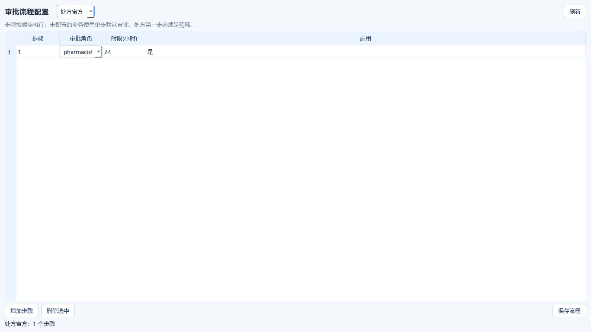
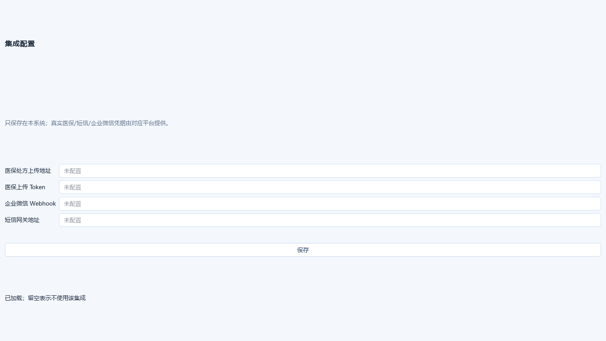
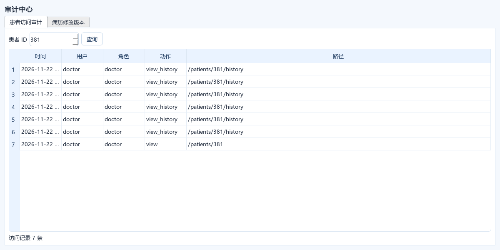
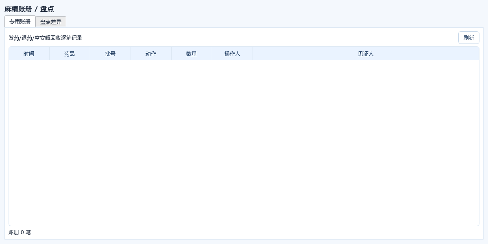
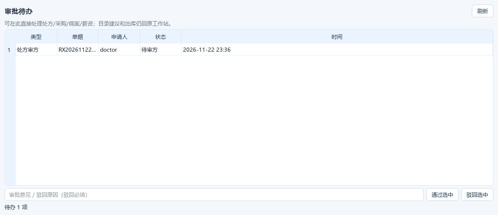

> **历史报告（1.2.4）**：结论仅代表当时版本；当前为 1.3.13，见 [文档索引](文档索引.md)。
# 实际运营测试报告

- 测试时间：2026-11-22 23:31 起（Asia/Shanghai）
- 服务端：`http://127.0.0.1:8001`，version `1.2.4`
- 测试方式：真实 HTTP 调用，不使用 TestClient
- 脚本：`scripts/e2e_full.py`
- 原始日志：`docs/e2e_run.log`
- 客户端：PySide6 offscreen 实际操作截图
- 客户端页签：22 个（含审计中心、麻精账册、通知中心、集成配置）

## 一、覆盖范围

| 环节 | 操作 | 结果 |
|---|---|---|
| 健康检查 | `GET /health` | 通过 |
| 主数据 | 建科室、医生、药品、入库 | 通过 |
| 建档挂号 | 患者、挂号、就诊 | 通过 |
| 病历 | 创建、修改、签名、版本查询 | 通过，版本 create/update/sign |
| 西药 | 开方、待审方、药师审方、收费、发药 | 通过 |
| 发药明细 | 实际批次、数量、金额、取药凭证 | 通过 |
| 退药 | 按发药记录退药 | 通过 |
| 处方中心 | 西药汇总、通用明细、单张打印 | 通过 |
| 中药 | 建饮片、开方、统一处方头、审核 | 通过 |
| 检验 | 申请、采样、接收、上机、报告、审核 | 通过 |
| 患者隐私 | 查看患者、历史诊疗、访问审计 | 通过 |
| 通知 | 待审批通知生成、派发 | 通过 |

## 二、本次实际数据

```text
患者：381
西药就诊：390
中药/检验就诊：391
西药处方头：271
中药处方：37
检验申请：157
发药单：125
```

真实接口调用：**41 次**

```text
E2E OK
```

## 三、关键验证点

### 西药闭环

```text
开方 → pending_review
药师审方 → approved
收费 → paid
发药 → dispensed
发药明细批次 = E2E{时间}
数量 = 2
单张处方打印包含“门诊处方”和药品名
退药 → 成功
```

### 中药闭环

```text
TCM 处方 → prescription_id 非空
统一处方头 type = tcm_herb
中药审核 → 处方头 approved
处方中心 tcm 列表可见
```

### 检验闭环

```text
申请 → 采样 → 接收 → 上机 → 报告 → 审核
最终状态 = reviewed
```

### 隐私与通知

```text
患者访问日志包含 view / view_history
药师通知包含待审批
POST /notifications/dispatch 成功
```

## 四、实际操作截图

### 医生处方中心



可见：

- 患者 E2E患者233225，就诊 390
- 处方 RX2026112200039001
- 状态“已审方”
- 明细 1 种
- 审核 pharmacist
- 底部按钮：编辑选中处方、上传选中处方医保、打印选中处方

### 药师处方审方



### 通知中心



### 审批流程配置



### 集成配置



### 审计中心



### 麻精账册/盘点



### 审批待办直接操作



实际操作：在药师账号的“审批待办”选中处方，点击“通过选中”，服务端处方状态从 `pending_review` 变为 `approved`。

同时修复：处理成功后提示被“待办 0 项”覆盖的问题；待办状态改为中文。

## 五、本轮 UI 按钮操作

| 操作 | 结果 |
|---|---|
| 药师点击“登记盘点” | 盘点单创建，差异 -1 |
| 院长点击“通过选中” | 盘点单 approved，库存按实盘数调整 |
| 院长在审批待办点击采购“通过选中” | 采购申请 submitted → approved |
| 药师在审批待办点击处方“通过选中” | 处方 pending_review → approved |

实际操作截图：

- `docs/e2e_shots/approval_inbox_action.png`
- `docs/e2e_shots/audit_center.png`
- `docs/e2e_shots/narcotic_center.png`

## 六、本次发现并修复的问题

1. **中药处方头混入西药审方列表**
   - 修复：`/pharmacy/prescription-reviews`、`/approvals/inbox` 排除 `type=tcm_herb`。

2. **中药处方头明细数显示 0**
   - 修复：`/prescriptions/headers` 的 `item_count` 改为按 `prescription_lines` 统计。

3. **未配置医保地址却显示 uploaded**
   - 修复：真实 HTTP 成功才 `uploaded`；未配置地址为 `local`。

4. **处方中心状态显示英文**
   - 修复：界面显示“待审方/已审方/已退回”等中文状态。

5. **审批待办操作成功提示被刷新覆盖**
   - 修复：先刷新再显示“已通过/已驳回”。

6. **审批待办状态显示英文**
   - 修复：显示“待审方/待审批”。

7. **多个工作站处理成功提示被列表刷新覆盖**
   - 涉及：审批待办、处方审方、目录建议、麻精盘点；
   - 修复：先刷新列表，再显示“已通过/已驳回”。

## 六、已知边界

- 企业微信/短信/医保真实平台没有凭据，未做外部真实发送；
- 真实医保签名、报文、回执无法本地伪造；
- 测试数据写入开发库 `his.db`，未清理；
- 未重新打包。

## 七、结论

```text
门诊核心运营链路：通过
中药统一处方头：通过
检验闭环：通过
患者访问审计：通过
通知与审批：通过
746 个自动化测试：通过
```

本轮实际运营测试通过。
