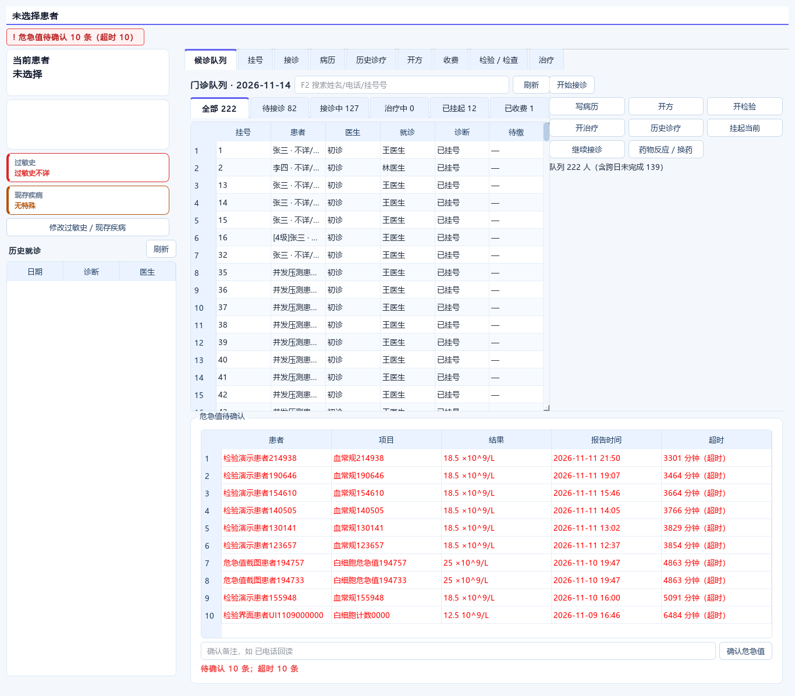
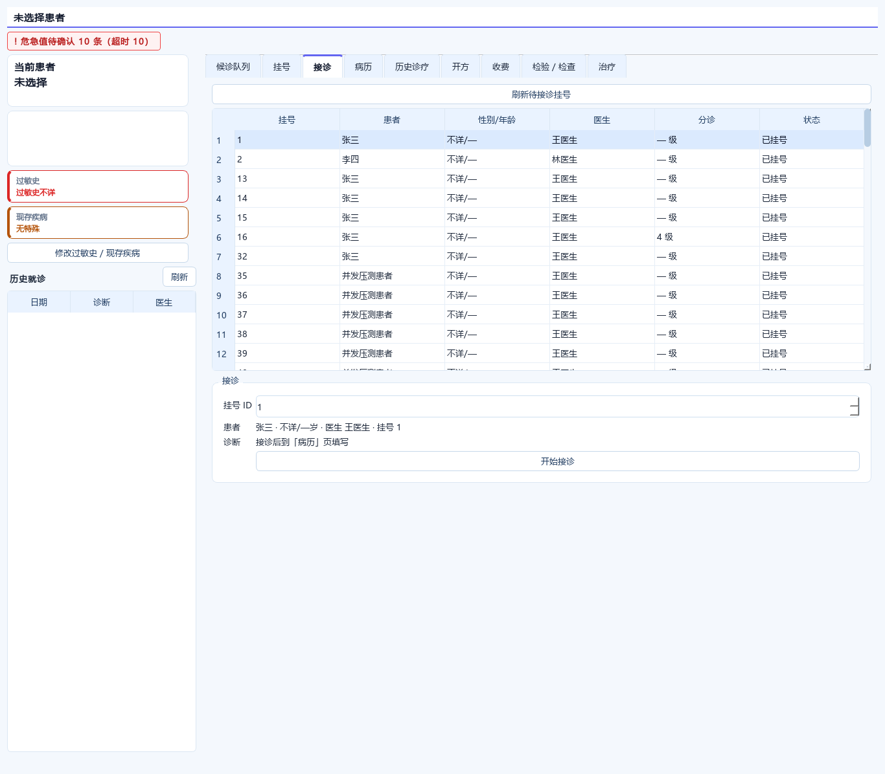
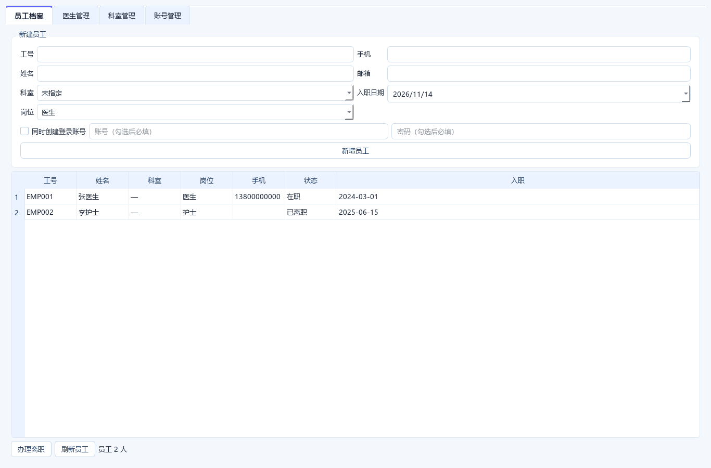

# 客户端布局审计（1.2.2）

## 一、审计方法

按真实门诊一天的使用顺序，逐屏检查：

```text
登录 → 主工作站 → 患者定位 → 接诊 → 病历/诊断 → 开方/检查/治疗
→ 收费 → 药房/库房 → 护士执行 → 治疗室 → 医技/病案/院长/人事
```

检查维度：

1. 当前任务是否第一眼可见
2. 患者身份、过敏、危急值是否始终可见
3. 高频动作是否在手边，低频动作是否收起
4. 表格列是否按任务优先级排列
5. 空状态是否知道下一步
6. 分栏能否调整，调整后是否记忆
7. 是否存在重复信息、错位信息、跨患者信息混排
8. 键盘是否可完成主要流程
9. 误操作是否有确认
10. 浅色/深色和 1366×768 下是否可用

## 二、通用布局原则

### 1. 三区结构

```text
左侧：患者上下文（是谁、过敏、既往）
中间：当前队列/工作对象（做什么）
右侧：当前对象动作（下一步）
底部：跨患者事项（危急值/提醒）
```

理由：

- 门诊医生的注意力顺序是“患者 → 任务 → 动作”
- 跨患者信息不能塞进单患者区域
- 固定区域比弹窗更适合高频工作

### 2. 一个屏幕只有一个主任务

- 登录：登录
- 收费：建档/挂号/收费
- 医生：接诊
- 药房：发药/退药
- 护士：分诊/执行
- 人事：员工/医生/科室/账号

### 3. 高频动作固定，低频动作收起

高频：

- 医生：开始接诊、写病历、开方、检验、治疗、挂起
- 收费：收费、退费、打印
- 药房：发药、退药
- 护士：分诊、叫号、执行

低频：

- 转初诊、药物反应、历史诊疗
- 系统设置、导出、批量操作

### 4. 表格先给结论，再给 ID

患者相关表格优先：

```text
患者姓名 / 性别年龄 / 医生 / 状态 / 金额
```

ID 只作为第二层信息或工具提示，不作为主列。

### 5. 分栏可调，状态可恢复

- 患者/队列/动作区用 `QSplitter`
- 危急值高度独立可调
- 尺寸写入客户端目录 `ui_state.ini`
- 不把“可调”做成一次性的临时状态

## 三、逐屏审计







| 页面 | 结论 | 处理 |
|---|---|---|
| 登录 | 单任务，宽度 460，字段顺序清楚 | 保留；IP/端口/账号记忆，密码不保存 |
| 主窗口 | 顶部工作站 + 全局患者条 | 保留；工作站名不与内层重复 |
| 医生-候诊队列 | 三栏：患者/队列/动作 | 队列 6 列，去掉低优先级“类型/挂号状态” |
| 医生-接诊 | 原表格只有 ID | 改为患者、性别年龄、医生、分诊、状态 |
| 医生-接诊诊断 | 诊断放在接诊按钮前，违反流程 | 删除诊断输入，接诊后到病历填写 |
| 医生-病历 | 诊断编辑器 + 9 个病历字段 | 保留两列网格，诊断置顶 |
| 医生-开方 | 药品目录 + 处方明细 | 保留左右分栏，常用用法在右 |
| 医生-检验/检查 | 开单 + 结果列表 | 保留；结果区优先 |
| 医生-治疗 | 治疗项目 + 明细 | 保留 |
| 医生-历史诊疗 | 患者检索 + 时间线 | 保留，表格上限 130px 避免挤压 |
| 医生-收费 | 费用明细 + 收费动作 | 保留；工作台只显示摘要 |
| 医生-患者360 | 跨就诊总览 | 独立页签，避免塞入接诊页 |
| 医生-中药 | 饮片目录 + 处方 | 独立页签，避免与西药混排 |
| 医生-危急值 | 原在单患者右栏，高度固定 | 改为工作台底部全宽，可拖动并记忆 |
| 收费-建档 | 2 列表单 + 查询结果 | 保留；字段分组符合建档顺序 |
| 收费-挂号/收费/退费 | 多页签任务 | 保留；收费动作在当前就诊下 |
| 药房-发药/退药 | 处方 + 明细 + 签名 | 保留；发药动作在右 |
| 药房-库房 | 入库/出库/库存 | 保留；库房独立工作站 |
| 护士-分诊 | 4 列生命体征 + 队列 | 保留；增加首屏自动加载队列 |
| 护士-治疗/输液 | 执行单 + 核对 | 保留；执行前核对患者 |
| 检验 | 左队列 + 右结果/审核 | 保留；增加首屏自动加载 |
| 治疗室 | 今日工作台 + 排队 + 随访 | 保留；表格拉满，避免右侧空白 |
| 病案 | 左档案列表 + 右建档/借阅 | 保留；状态和库位优先 |
| 院长 | 左审批队列 + 右详情 | 保留；增加首屏自动加载 |
| 人事 | 员工/医生/科室/账号四页签 | 保留；新建员工改两列，减少空白 |
| 登录记忆 | 无 | 新增；配置可调 |

## 四、本次关键调整

### 1. 危急值横跨底部

危急值是**跨患者**信息，不属于当前患者右栏。

新结构：

```text
┌──────────────┬──────────────┐
│ 患者/队列     │ 当前患者动作   │
├──────────────┴──────────────┤
│ 危急值（全宽，高度可拖动）     │
└─────────────────────────────┘
```

好处：

- 表格列不再被 400px 右栏挤成省略号
- 与“当前患者费用/操作”明确分开
- 高度可调，适合多条危急值同时查看

### 2. 费用表从危急值上方移除

原表是当前就诊的：

```text
项目 / 数量 / 金额 / 状态
```

它应该服务于“当前患者收费”，不应该占据跨患者危急值的上方。现在：

- 工作台只保留费用摘要
- 完整明细在「收费」页
- 危急值获得独立空间

### 3. 接诊前诊断入口删除

诊断属于病历，不属于挂号/建立就诊：

```text
挂号 → 接诊 → 问诊/查体 → 病历诊断 → 开方
```

工作台和接诊页都不再出现诊断输入框。

### 4. 表格列按任务重排

医生队列从 8 列缩减为 6 列：

```text
挂号 / 患者 / 医生 / 就诊 / 诊断 / 待缴
```

类型、挂号状态等低频信息合并进患者文本或患者卡，避免 1366 宽度下出现横向滚动。

### 5. 首屏加载

护士、检验、院长进入工作站时自动加载队列，避免出现“空白首屏，必须先点刷新”。

## 五、为什么这样合理

### 信息层级

```text
一级：我是谁、当前患者是谁
二级：我现在要处理谁
三级：下一步动作
四级：跨患者提醒
```

### 人的操作习惯

- 从左到右：患者 → 任务 → 动作
- 从上到下：身份 → 队列 → 详情 → 提醒
- 高频动作固定，不需要层层展开
- 危险动作（辞退、停用、销毁、退费）二次确认

### 门诊安全

- 过敏史、危急值、隔离提示始终可见
- 危急值不依赖一次性弹窗
- 跨患者信息不与单患者费用混排
- 诊断在病历中留痕，不在接诊按钮前抢跑

## 六、参考

- 门急诊医生工作站通常由接诊、处方、病历、辅助诊断、诊断文书等组成：[广东门急诊工作站材料](https://gdgpo.czt.gd.gov.cn/gpx-bid-file/441821/gpx-tender/2022/5/12/8a7e20c980a4383f0180b647b32a5f12.docx?accessCode=7c23a170c6cbdec2d2753128d8fb8aab#18#23#18)
- 门诊医生站支持带入历史病历、诊断、医嘱：[青岛门诊医生站材料](https://ggzy.qingdao.gov.cn/PortalQDManage/PortalQD/GetZbDownLoad?id=105946&filePOrB=2#6#14#6)
- 危急值闭环管理强调提醒、确认、追踪，而不是只弹一次窗：[危急值信息化管理案例](http://mp.weixin.qq.com/s?__biz=Mzg2NTg4MjQ4MA==&mid=2247516410&idx=1&sn=16f33f0c05ad5b49c41a986bded6a45c)

## 七、复核边界

- 登录、医生、收费、药房、护士、检验、治疗室、病案、院长、人事已按角色截图检查
- 1366×900 离屏截图检查
- 浅色/深色主题切换检查
- 仍需要真实诊室大屏、触摸屏、老花镜用户现场试用；布局不能只靠截图判断
- 打印机、扫码枪、读卡器等外设布局不在本次静态截图中验证
