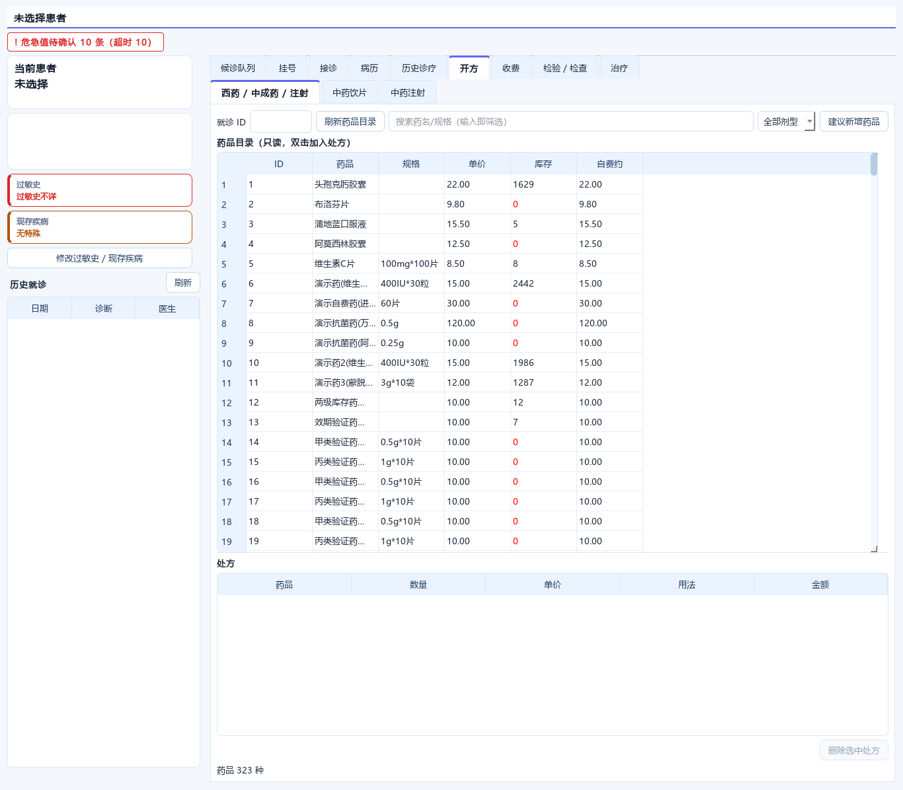

# 开方、目录与新增项目审批评估

## 一、结论先说

这次能直接改的：

- 未选患者时，右侧临床动作全部禁用
- 药品目录改为明确只读，双击只加入处方，不能编辑
- 增加“删除选中处方”，同步取消未收费费用

需要分阶段做的：

- 处方草稿行、药品首字母搜索、规格/用法下拉
- 西药/中药/治疗共用一个处方篮
- 医生提交新增药品/治疗项目审批

原因是不是界面不够漂亮，而是后者需要：

- 处方草稿状态
- 批量保存接口
- 主数据审批状态机
- 药品/治疗项目的审核人、审核时间、驳回原因
- 与收费、药房、库房、院长的权限边界

只做一个“新增药品”按钮而不接审批，等于让医生绕过药事管理，不能这样做。

## 二、未选患者时按钮

已改：

```text
未选患者
→ 开始接诊禁用
→ 写病历/开方/开检验/开治疗/历史诊疗/挂起/继续/药物反应全部禁用
```

选中待接诊患者：

```text
开始接诊可用
临床动作仍禁用，因为还没有就诊
```

接诊后：

```text
写病历、开方、检验、治疗、历史诊疗可用
```

已收费：

```text
临床修改动作禁用，只保留历史查看
```

## 三、医生不能修改药品目录

已明确：

- 药品目录表只读
- 双击/单击只做“选中并加入处方”
- 没有药品编辑、删除、改价入口
- 新增药品只能走管理员/药事审批

医生站在目录区只应做：

```text
查药 → 选药 → 开方
```

不应做：

```text
新增药品
改价
改医保比例
删除目录
```

## 四、处方交互应该怎样

推荐目标：

```text
左侧：药品目录（只读）
右侧：处方草稿篮
```

### 处方草稿篮

一张表，列：

```text
药品 | 规格 | 数量 | 用法用量 | 天数 | 金额 | 操作
```

操作：

- “新增空行”生成一行空白
- 双击药品目录，填入第一个空白行；没有空行则自动新增
- 单击药品目录，也填入当前空白行
- 删除按钮删除当前行
- 药品列是可编辑下拉框
- 输入药品首字母/常用缩写筛选
- 规格列确定唯一药品
- 用法用量使用下拉框
- 天数可编辑
- 金额自动计算
- 最后统一“提交处方”

### 为什么不是现在这样

现在的结构是：

```text
药品目录 + “开立处方”表单 + 已开处方表
```

问题：

- 医生要反复在目录和表单之间搬数据
- “开立处方”框占了右栏
- 双击只是选中，不是加入
- 处方篮不能直接编辑
- 删除没有统一入口

### 为什么需要草稿状态

如果双击就立即调用后端：

- 每点错一次就产生一条处方和一条费用
- 过敏/相互作用提示会反复打断
- 无法一次调整多行后再提交

所以正确流程是：

```text
加入草稿篮 → 调整数量/用法 → 统一提交 → 后端校验/计费
```

## 五、首字母搜索

药品目录需要：

- 药品名
- 拼音首字母
- 常用缩写
- 规格

例如：

```text
amxl → 阿莫西林
aspl → 阿司匹林
tkt → 头孢克肟
```

当前 Drug 表没有拼音字段。实现方式：

1. 加 `pinyin` / `pinyin_initials` 字段
2. 维护药品时生成
3. 客户端输入时匹配
4. 规格列做唯一确定

不建议在客户端临时硬编码拼音，数据量大且不可维护。

## 六、中药、西药、治疗共用一个处方框

建议统一为：

```text
本次诊疗
├─ 西药/中成药
├─ 中药饮片
├─ 治疗/处置
└─ 外治（针灸/拔罐/艾灸/推拿）
```

每个区域有自己的字段，但共用一个“提交本次诊疗”动作。

技术上需要：

- 一个处方草稿聚合接口
- 或三个子接口 + 前端草稿合并
- 提交时统一生成处方、治疗单、费用
- 任一项失败时明确回滚/保留草稿

不建议只是把三个独立页面硬塞进一个 `QTableWidget`，否则状态会混乱。

## 七、针灸、拔罐放哪里

不建议放进“中药饮片处方”。

正确归属：

```text
治疗 / 处置
```

原因：

- 针灸、拔罐、艾灸、推拿是操作项目，不是饮片
- 需要治疗室排队、知情同意、执行人、执行时间
- 收费按治疗项目，不按饮片克数
- 需要护士/治疗室执行

推荐目录分类：

```text
charge_items.category = treatment
```

名称示例：

```text
普通针刺
电针
拔罐
艾灸
推拿
穴位贴敷
```

如果希望中医医生站集中开，可在中医页增加“中医外治”子区，但底层仍走治疗单，不混入饮片处方。

## 八、医生新增药品/治疗项目的正确流程

### 药品

```text
医生提交新增药品建议
→ 药房审核（临床需要/同类药/库存）
→ 药事/药剂科审批
→ 采购/库房入库
→ 管理员维护药品目录和价格
→ 医生才能开方
```

不建议医生直接新增药品目录。

### 治疗项目

```text
医生提交新技术/新治疗项目申请
→ 医务科/院长审批
→ 核定价格、适应症、禁忌症、知情同意
→ 管理员维护收费项目
→ 医生开立、治疗室执行
```

### 其他医院常见做法

公开医院信息化材料通常把医生站定位为“接诊、病历、处方、辅助诊断、诊断文书”，药品和收费项目属于主数据，由药事/财务/信息部门维护，医生只能选择，不直接改目录。

新增项目一般走：

- 药事管理与药物治疗学委员会
- 新技术/新项目审批
- 价格公示
- 目录维护
- 权限与审计

## 九、实施顺序建议

### 第一阶段（已做）

- 未选患者禁用动作
- 药品目录只读
- 删除选中处方及未收费费用
- 批量处方接口 `POST /encounters/{id}/prescriptions/batch`
- 失败整批回滚

### 第二阶段（已做）

- 取消西药处方草稿篮
- 药品目录在上、处方在下
- 双击目录弹出用法/数量/天数，直接入方
- 处方可删除未收费项目
- 药品拼音首字母检索
- 中药饮片页同样上下排列
- 新增独立“中药注射”页



### 第三阶段（待做）

- 中药注射目录的正式分类字段
- 中医外治项目
- 规格唯一确定的高级选择器
- 批量处方中的过敏 override 流程

### 第四阶段（已做）

- `catalog_proposals` 建议表与迁移 0091
- 医生提交新药品/新治疗项目建议
- 药事审核工作站
- 库房审核工作站
- 院长治疗项目审批
- 审批通过后自动建立 Drug / ChargeItem
- 审批记录：审核人、意见、时间、状态

仍待做：

- 采购执行工作站（下单/分批收货）
- 医务科两级审批（当前院长直接审批）
- 建议附件/证据材料

## 十、当前边界

- 已收费处方不能删除
- 删除处方只删除未收费费用
- 审批流尚未落库，不能用一个按钮假装审批
- 针灸/拔罐应归治疗项目，不归饮片处方
