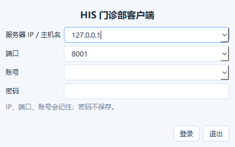
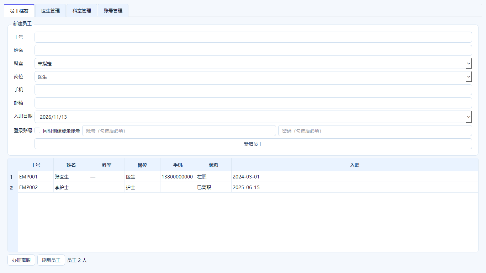

# 登录记忆与人事工作站（1.2.0）

## 登录记忆



客户端登录页拆成：

```text
服务器 IP / 主机名  [可编辑下拉]
端口               [可编辑下拉]
账号               [可编辑下拉]
密码               [不记忆]
```

- IP、端口、账号各保留最近 N 个
- 密码不写入磁盘
- 最近使用的值排在最前
- 默认保留 10 个

配置文件 `config.ini`：

```ini
[client]
remember_login = true
remember_limit = 10
```

- `remember_login = false`：关闭记忆
- `remember_limit`：1–50，默认 10

记忆文件：

```text
客户端目录/login_history.json
```

只包含 `hosts`、`ports`、`usernames`，不包含密码。

## 人事工作站



新增角色：

```text
hr（人事）
```

客户端登录 hr 账号后只显示 **人事工作站**。管理员也可以在管理客户端看到人事工作站。

四个页签：

### 员工档案

- 工号、姓名、科室、岗位、手机、邮箱、入职日期
- 新增员工
- 办理离职
- 可勾选“同时创建登录账号”，填写账号/密码后同步创建

### 医生管理

- 新增医生
- 停用/辞退医生（软删除，不破坏历史病历/挂号）
- 有未完成就诊的医生不能停用

### 科室管理

- 新增科室
- 停用科室（软删除）
- 科室仍有在职医生时不能停用

### 账号管理

- 创建登录账号
- 选择角色
- 可关联员工 ID
- 人事不能创建 admin/director 账号
- 管理员仍可创建全部角色

## 软删除规则

医生、科室不物理删除：

```text
active = 0
```

原因：

- 历史挂号、病历、处方仍引用医生/科室
- 物理删除会导致历史数据断链
- 停用后新挂号/新医生列表不再出现

## 权限

- `hr`：员工、医生、科室、普通账号
- `admin`：全部
- 其他角色不能调用人事写接口

## 服务端仍保留的管理功能

以下继续放 Web 管理台更合适：

- 用户/角色权限总控
- 收费项目、药品、耗材、供应商主数据
- 医保目录、价格、票据
- 审计日志、财务报表、BI
- 数据库备份/系统设置

可逐步搬到客户端的：

- 科室、医生、员工
- 药品/收费项目基础资料
- 排班
- 供应商/库房主数据

涉及资金、权限、审计、系统配置的功能不建议全部搬到客户端。

## 验证

- pytest：668 passed
- 新增测试：
  - 人事软删除医生/科室
  - 有医生时不能停用科室
  - 人事创建员工 + 登录账号
  - 收费员不能创建账号
- 客户端登录记忆：密码不保存
