# 门诊工作站前端重构（逐页签）

- 日期：2026-11-23
- 范围：`his_client/ui/doctor.py` 门诊工作站全部 9 个顶层页签 + 开方下 4 个子页签 + 历史诊疗下 6 个子页签
- 验证数据：真实开放就诊 `357`（2 张处方、2 个检验、1 个治疗、已签病历、8 项待收费用）
- 尺寸：1600×1000 与 1366×768 实拍
- 原则：参考门诊医生站“左患者上下文、中任务队列、右当前动作、底部跨患者危急值”的行为结构，不复制厂商配色/代码

## 一、重构前发现的真实问题

| 问题 | 证据 | 影响 |
|---|---|---|
| 窗口被撑到 1600×1196 | 病历 9 个字段的 QTextEdit 最小高度把 QTabWidget 撑高 | 1366×768 下窗口超出屏幕 |
| 就诊 ID 显示空白 | `QSpinBox.setReadOnly(True)` 后内部 lineEdit 宽度变 1px | 医生不知道当前操作的是哪个就诊 |
| 已签病历仍可编辑 | 输入框只加载数据，未按签名/收费状态禁用 | 医生会尝试修改，提交才报错 |
| 开方页当前处方为空 | `_wb_prescribe` 只刷药品目录，不刷当前处方 | 医生看不到患者已有用药，可能重复开方 |
| 收费页不自动带出当前就诊 | `_set_encounter_everywhere` 未同步 PaymentPanel | 已选患者后收费页仍空白，需要重新手填 |
| 检验页开单下拉为空 | `_wb_exam` 不加载检验/检查目录 | 无法开单，必须先点“刷新” |
| 检验状态英文 | 表格直接展示 `reported/pending` | “已报告/待采样”不直观 |
| 历史页患者表空白 | 只填就诊表，不填当前患者行 | 页面显示“患者：…”但患者表为空 |
| 药房式大表最后一列吞空间 | 药品目录、处方明细使用最后列拉伸 | 药名/规格被压缩 |
| 队列患者列被压缩 | 8 列在 1366 宽度下内容列过多 | 患者姓名显示成“医…” |

## 二、逐页签重构

### 1. 门诊队列

**显示**

- 顶部患者条：姓名、性别/年龄、患者号、过敏、就诊号、状态；
- 左侧当前患者：就诊、状态、电话、过敏、现存疾病、历史就诊；
- 中部队列：挂号、患者、类型、挂号状态、就诊、诊断、待缴（医生本人的队列不重复医生列）；
- 右侧当前患者动作：写病历/开方/开检验/开治疗/历史/挂起/继续/药物反应；
- 右下危急值确认，跨患者固定。

**本轮改动**

- 患者/诊断列改为优先拉伸，移除医生本人的重复“医生”列，把宽度让给患者姓名/诊断；
- 移除初始化中重复创建的 page/splitter；
- 收费/开方/病历动作切页时自动同步当前就诊；
- 医生账号绑定 `doctor_id` 时，后端 worklist 只返回本人队列；未绑定账号保留全院兼容视图。

**保留**

- 双击行开始接诊；
- 未接诊只允许“开始接诊”，已接诊才开放写病历/开方；
- 危急值固定在跨患者区域，不塞进当前患者卡。

**仍待做**

- 空队列/搜索无结果统一空状态；已补“暂无匹配患者，调整搜索条件或刷新”。
- 患者列在 1366 下仍可继续加宽，需和医生列/状态列再平衡。

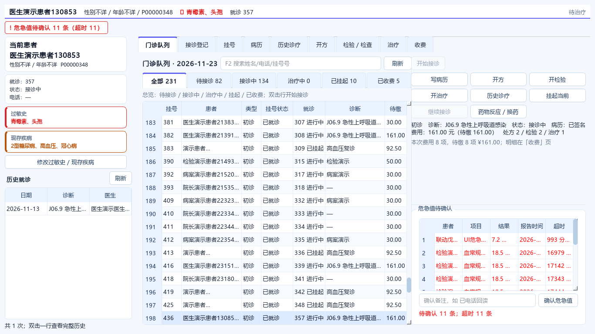

### 2. 接诊登记

**显示**

- 顶部待接诊挂号表：挂号、患者、性别/年龄、医生、分诊、状态；
- 底部接诊卡：挂号 ID、患者、诊断提示（接诊后到病历填写）、开始接诊。

**本轮检查**

- 表格列宽和患者身份可读；
- 接诊 ID 默认值为当前选中挂号，不再默认 `1`；
- 接诊成功自动进入病历页，避免停在队列以为没反应。

**取舍**

- 已改为左接诊列表 + 右接诊详情/动作，空状态“暂无待接诊挂号”；
- 右侧只保留挂号 ID、患者、诊断提示和开始接诊，低频信息不挤占列表。

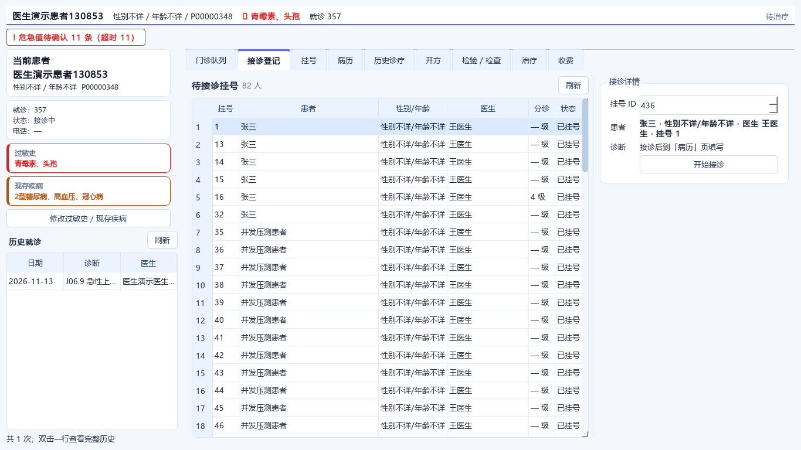

### 3. 挂号

**显示**

- 左侧患者检索：姓名、身份证号（仅检索不显示）、结果表；
- 右侧快速建档并挂号：姓名、手机号、性别、身份证、出生日期、年龄、处理方式；
- 下方现场挂号：已选患者、医生、挂号。

**本轮检查**

- 身份证检索不显示证件号，符合隐私要求；
- 出生日期/年龄联动；
- 快速建档与现场挂号分区明确。

**仍待做**

- 患者检索默认空表无“输入条件查询”提示；
- 现场挂号医生默认“陈医生”，未强制当前登录医生；
- 建档字段多，1366 下右侧表单需要滚动，后续可折叠低频联系方式。

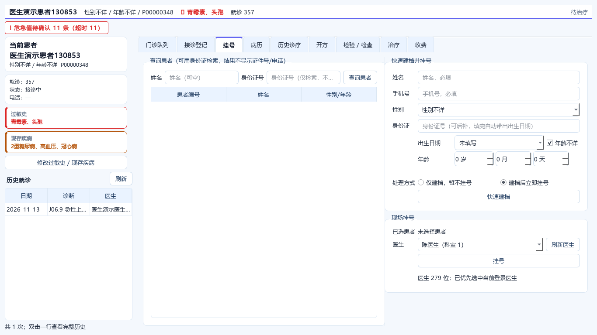

### 4. 病历

**显示**

- 顶部：就诊 ID、载入病历、病历模板、套用、诊断摘要；
- 诊断编辑器：顺序/类型/编码/诊断/备注；
- 9 个病历字段双列：主诉、现病史、既往史、个人史、婚育史、家族史、体格检查、辅助检查、处理意见；
- 底部：保存/更新、签名锁定、质控评分、状态消息。

**本轮改动**

- 整个病历页放入 QScrollArea，门诊窗口不再被撑到 1196 高；
- 就诊 ID 改为只读 QLabel，解决空白；
- 已签名/已收费时：
  - 字段只读；
  - 诊断编辑器只读；
  - 保存/签名/保存诊断禁用；
  - 顶部显示“【只读】病历已签名；全额退费后自动解锁修订”；
- 未签名时显示“可编辑病历”。

**仍待做**

- 诊断表“诊断”列在 1366 下仍省略，可加 tooltip/详情；
- 签名后可增加“申请修订”而不是只等全额退费；
- 质控结果目前显示在底部消息，可做独立评分卡。

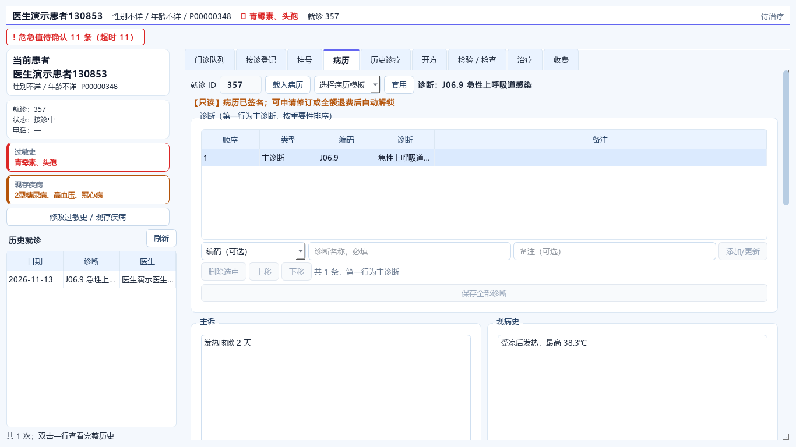

### 5. 历史诊疗

**显示**

- 患者检索；
- 当前患者行；
- 就诊历史表；
- 下方 6 个子页签：病历、处方、检验、治疗、收费、支付。

**本轮改动**

- 当前患者自动填入患者表并选中，不再出现“标签有患者、患者表空白”；
- 历史就诊第一行自动选中并渲染详情；
- 病历只读，处方/检验/治疗/收费/支付按就诊聚合。

**仍待做**

- 历史检验趋势已支持双击同名检验项目查看历次结果；
- 医生站收费面板改为紧凑模式，减少重复选择。
- 历史病历整段复制；
- 多就诊对比。

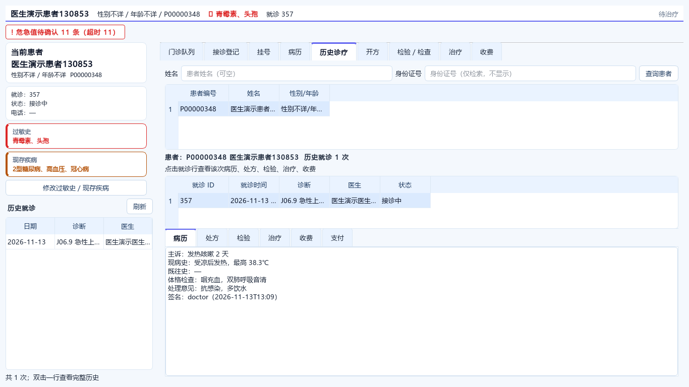

### 6. 开方

**显示**

- 子页签：西药/中成药/注射、中药饮片、中药注射、处方中心；
- 药品目录：ID、药品、规格、单价、库存、自费约、医保比例、医保类别；
- 当前处方：药品、数量、单价、用法、金额、状态；
- 删除选中处方。

**本轮改动**

- 切换开方页或选择患者后自动刷新当前处方，不再空白；
- 药品目录改为药名/规格拉伸，ID/价格/库存/医保按内容宽；
- 当前处方改为药品/用法拉伸，数量/单价/金额/状态按内容宽；
- 已有处方显示“已审方”，避免医生重复开方；
- 药品库存为 0 时双击会提示“库存为 0，不能开方；请先请领”。

**仍待做**

- 已增加“编辑选中处方”入口，可改数量/剂量/频次/途径/天数；
- 中药注射目录已补“丹参注射液”演示数据（剂型=注射液），页面可显示并双击开方；
- 处方中心状态和退费/发药联动提示可加强。

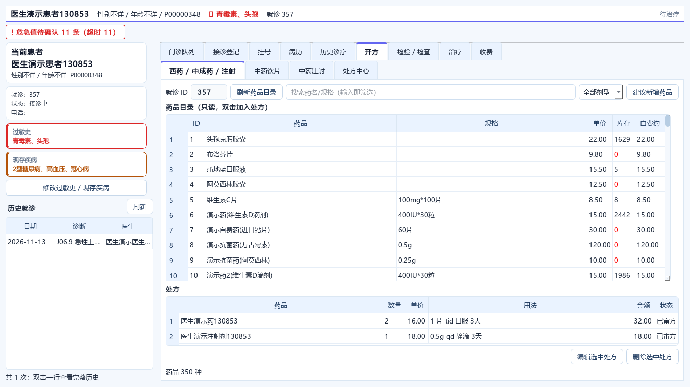

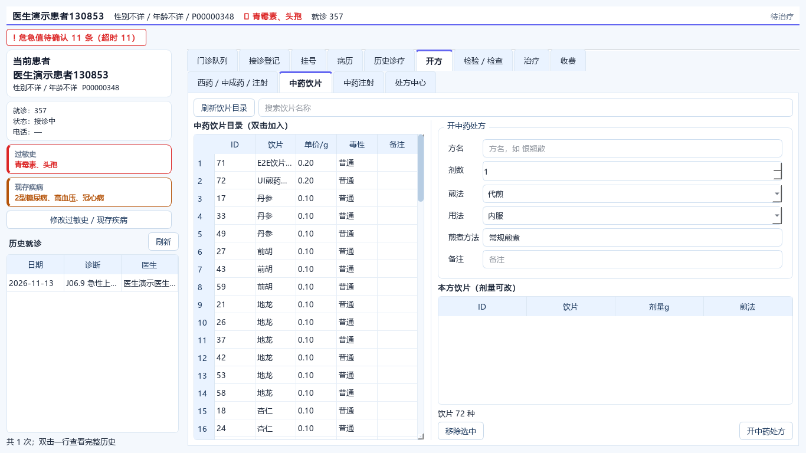

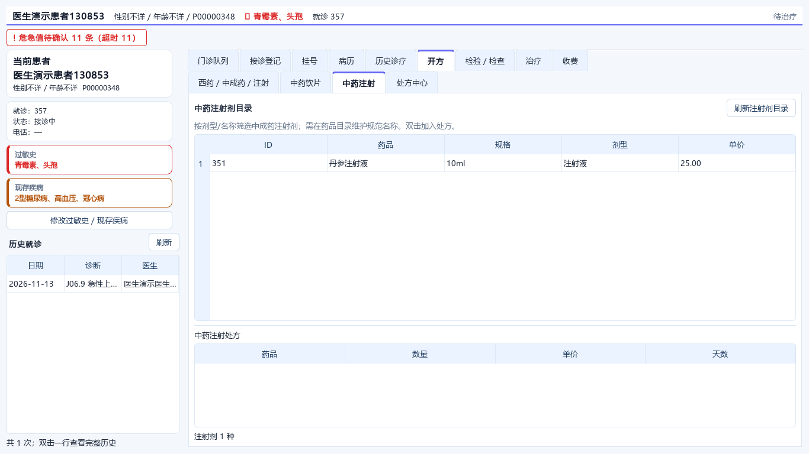

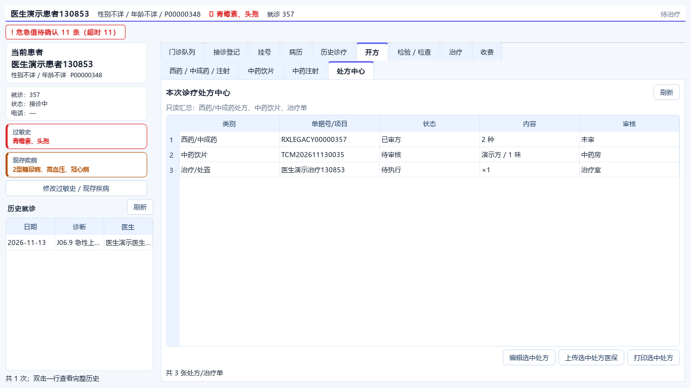

### 7. 检验 / 检查

**显示**

- 就诊 ID；
- 检验开单：项目、刷新、开单；
- 检查开单：项目、刷新、开单；
- 本次已开检验/检查表：类型、项目、状态、结果、时间。

**本轮改动**

- 进入页签自动加载检验/检查项目目录，不再空下拉；
- 状态从英文 `reported/pending` 转为“已报告/待采样”；
- 已有检验单自动加载；
- 就诊 ID 改为只读标签，可见 357。

**仍待做**

- 时间列接口返回为空，需后端补 created_at/reported_at；
- 结果异常/危急值缺颜色分级；
- 历史趋势未接入。

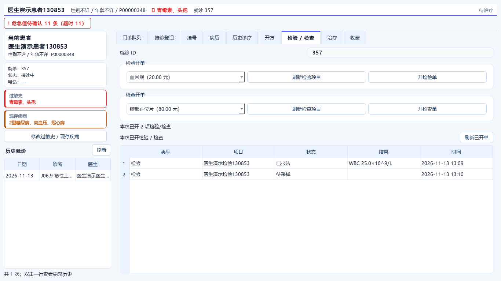

### 8. 治疗

**显示**

- 开治疗单：就诊 ID、治疗项目、数量、备注、刷新/建议新增/开单；
- 本次已开治疗表：项目、数量、状态、执行人。

**本轮检查**

- 就诊 ID 改为只读标签；
- 进入页签自动加载治疗项目和已开治疗；
- 状态显示“待执行”等中文。

**仍待做**

- 表格下方大面积空白，可补“治疗执行进度/注意事项”；
- 开单后缺少直接跳转治疗室执行的入口；
- 模板治疗项目未做常用套餐。

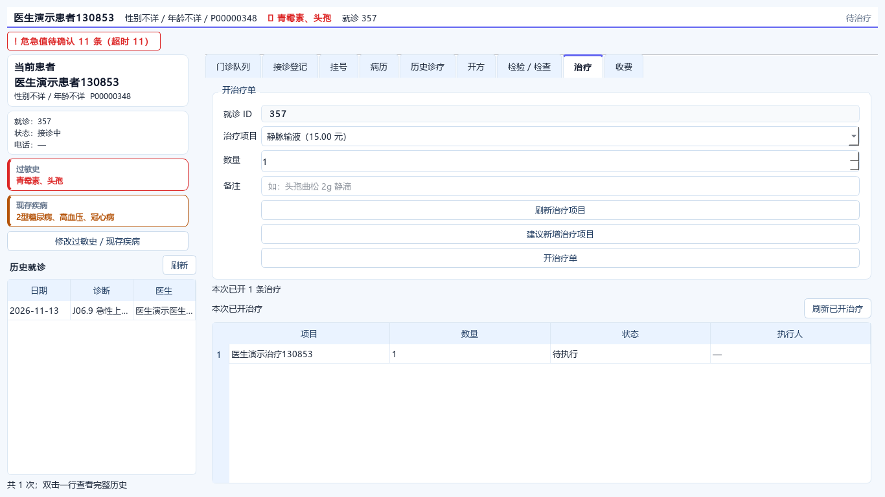

### 9. 收费

**显示**

- 扫码带出；
- 患者搜索；
- 就诊 ID + 就诊下拉（当前患者全部就诊）；
- 支付方式、付款码/卡号；
- 费用明细表：类型、项目、数量、金额、状态；
- 待收/已收汇总。

**本轮改动**

- 医生站使用紧凑收费面板，隐藏重复的“查患者/就诊下拉”；
- 选中患者/接诊后自动同步 PaymentPanel 当前就诊；
- 自动加载该就诊费用，不再要求医生重新手填；
- 患者下拉和就诊下拉联动；
- 收费完成后刷新队列并清空当前患者。

**仍待做**

- 收费页与药房/收费员共用面板，医生站可进一步隐藏“医保目录”等无关项；
- 退费入口在医生站是否开放需按医院制度决定；
- 待收费用表缺少按类型分组小计。

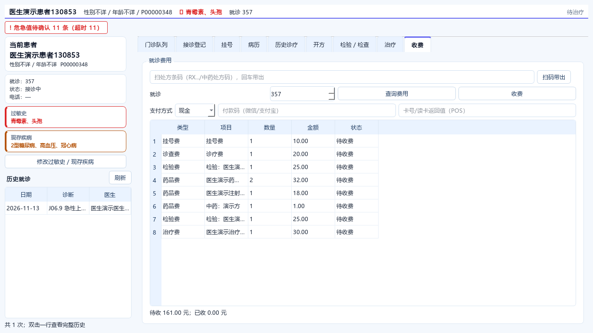

## 三、共性问题与统一策略

### 显示

- 当前患者三层信息（顶部患者条、左侧患者摘要、页内摘要）有重复；保留顶部条+左侧摘要，页内只保留任务摘要；
- 所有“就诊 ID”只读展示统一用标签，不再用只读 QSpinBox；
- 状态统一走 `zh()` 映射，禁止表格直接显示英文状态；
- 金额、库存、危急值、过敏用颜色/加粗区分，但不同时使用多种警示色。

### 操作

- 进入页签时自动加载该页数据，不要求用户先点“刷新”；
- 未接诊禁用病历/开方/检验/治疗；
- 已签名/已收费禁用病历编辑；
- 开方页必须同时展示“药品目录”和“当前处方”，避免重复开药；
- 收费页自动带出当前就诊，手填仅兜底；
- 高风险操作（签名、删除处方、退费）保留确认。

### 布局

- 病历页独立滚动，不能撑高整个工作站；
- 队列患者/诊断优先，ID/状态按内容；
- 开方药品/当前处方上下分栏，比例可调；
- 收费页操作区固定在上，明细表占剩余高度；
- 1366×768 必须完整显示主操作，不依赖 1600 宽屏。

## 四、验证

```text
796 passed
Alembic 0139 (head)
SELF-TEST OK tabs=25 widgets=5
```

门诊窗口实测：

```text
1366×768 可完整显示
minimumSizeHint ≈ 1134×739
病历页可滚动
```

## 五、后续优先级

P0：暂无阻塞项。

P1：

- 历史检验趋势已补轻量折线图和参考区间色带。

P1：

- 中药注射目录已用演示注射剂验证；真实院内目录待导入。
- 收费页医生站精简；
- 病历修订申请流程；
- 队列/历史空状态。

P2：

- 表格列宽持久化；
- 常用医嘱套餐；
- 病历模板扩展。
