# 上海哲策 HIS Gitee 首页

- 来源：https://gitee.com/sh_kyoui_admin/hospital-information-systemhis
- 原始 HTML：reference/web/shanghai-his-gitee.html
- 抓取时间：2026-11-22

---

医院信息系统_HIS: 医疗信息系统（Hospital Information System，简称 **HIS**）是基于低代码平台构建的企业级医院综合管理系统。系统覆盖医院从患者挂号、门诊就诊、住院诊疗、药房药库、检验检查、电子病历、收费结算到病案归档的全流程数字化管理，同时支持医保接口对接、耗材管理、临床路径、健康体检、质控评分、AI等扩展功能。

登录
注册

开源

企业版

高校版

搜索

帮助中心

使用条款

关于我们

开源
企业版
高校版
私有云

模力方舟

AI 队友

登录
注册

代码拉取完成，页面将自动刷新

Watch

不关注

关注所有动态

仅关注版本发行动态

关注但不提醒动态

2

Star
6

Fork
4

 上海哲策 / 医院信息系统_HIS

代码

Issues

0

Pull Requests

0

Wiki

统计

流水线

服务

JavaDoc

质量分析

Jenkins for Gitee

腾讯云托管

腾讯云 Serverless

悬镜安全

阿里云 SAE

Codeblitz

SBOM

开发画像分析

我知道了，不再自动展开

加入 Gitee

与超过 1400万 开发者一起发现、参与优秀开源项目，私有仓库也完全免费 ：）

免费加入

已有帐号？
立即登录

返回

master

分支 (1)

管理

管理

 master

克隆/下载

克隆/下载

HTTPS
SSH
SVN
SVN+SSH

下载ZIP

提示

下载代码请复制以下命令到终端执行

为确保你提交的代码身份被 Gitee 正确识别，请执行以下命令完成配置

git config --global user.name userName 
git config --global user.email userEmail

初次使用 SSH 协议进行代码克隆、推送等操作时，需按下述提示完成 SSH 配置

1
生成 RSA 密钥

2
获取 RSA 公钥内容，并配置到 SSH公钥 中

在 Gitee 上使用 SVN，请访问 使用指南 

使用 HTTPS 协议时，命令行会出现如下账号密码验证步骤。基于安全考虑，Gitee 建议 配置并使用私人令牌 替代登录密码进行克隆、推送等操作

Username for 'https://gitee.com': userName

Password for 'https://userName@gitee.com':
#

私人令牌

新建文件

新建 Diagram 文件

新建子模块

上传文件

分支 1

标签 0

贡献代码

同步代码

创建 Pull Request

了解更多

对比差异

通过 Pull Request 同步

同步更新到分支

通过 Pull Request 同步

将会在向当前分支创建一个 Pull 
Request，合入后将完成同步

 呼啸起

add LICENSE.

f1bde07

14 次提交

提交
取消

提示:
由于 Git 不支持空文件夾，创建文件夹后会生成空的 .keep 文件

.gitee

保存
取消

.idea

保存
取消

HIS-boot-module

保存
取消

assets

保存
取消

docs

保存
取消

.gitignore

保存
取消

LICENSE

保存
取消

README.en.md

保存
取消

README.md

保存
取消

Loading...

README

Apache-2.0

# 医疗信息系统 - 用户操作手册

> **版本**：v3.8.0\ 作者：呼啸起
> **更新日期**：2026-08-16\
> **适用范围**：门诊、住院、药房药库、检验检查、电子病历、收费结算等全流程业务

***

## 1 系统概述

### 1.1 系统简介

医疗信息系统（Hospital Information System，简称 **HIS**）是基于低代码平台构建的企业级医院综合管理系统。系统覆盖医院从患者挂号、门诊就诊、住院诊疗、药房药库、检验检查、电子病历、收费结算到病案归档的全流程数字化管理，同时支持医保接口对接、耗材管理、临床路径、健康体检、质控评分、AI等扩展功能。

### 1.2 技术架构

| 层级 | 技术选型 | 版本 |
| :--------- | :-------------------------------- | :---------------- |
| **后端框架** | Spring Boot | 2.7.18 |
| **持久层** | MyBatis-Plus + Dynamic Datasource | 3.5.3.2 / 4.1.3 |
| **数据库连接池** | Druid | 1.2.24 |
| **数据库支持** | MySQL / 达梦8 / 金仓8 | MySQL 5.7+/8.0 |
| **安全框架** | Apache Shiro + JWT | 2.0.4 / 4.5.0 |
| **缓存** | Redis | - |
| **前端框架** | Vue 3 + TypeScript + Vite | Vue 3.5+ / Vite 5 |
| **UI组件库** | Ant Design Vue | 4.2.6 |
| **富文本编辑器** | ThinkEditor / Tinymce | - |
| **报表引擎** | 积木报表 JimuReport | 1.9.5.1 |
| **工作流** | Quartz 定时任务 | 2.4.1 |
| **JDK要求** | Java | 17+ |
| **Node要求** | Node.js | 20+ |

#### 1.2.1 系统架构图

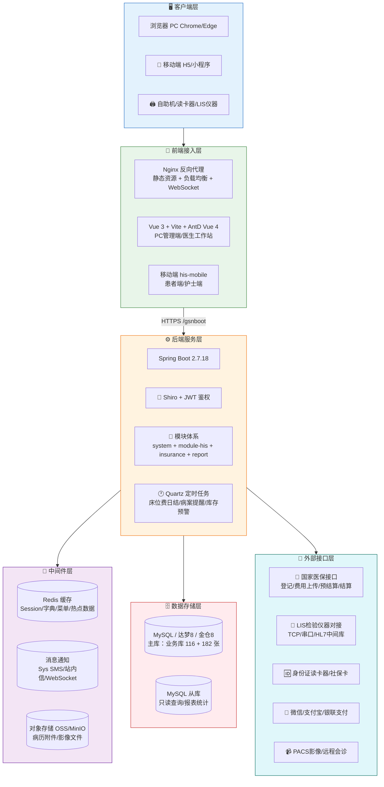

***

### 1.3 系统功能总览

#### 1.3.1 系统功能全景图

```mermaid
mindmap
 root((**医疗信息系统 HIS**))
 🏥 门诊管理
 门诊挂号 cmRegistration
 门诊就诊/病历 cm
 门诊处方 cmDrugadvice
 门诊收费结算 cmCostBalance
 门诊药房发药 pharmacy
 门诊皮试 drugSkinTest
 门诊病案 patientArchive
 🏨 住院管理
 住院登记 Inpatient
 病区入科/出科 inDept/outDept
 长期/临时医嘱 orderExe
 医嘱审核 orderExamine
 摆药发药 sendMed
 护理/体温/输液 nursing
 出院结算 outPayInfo
 住院病案 ipPatientArchive
 💊 药房药库
 药品字典 DrugDictionary
 药品入库 departTranfer
 药品调拨出库 DmSout
 药品盘点 drugStoreStock
 药品报损 drugLoss
 药品调价 drugPrice
 库存查询 drugInventory
 进销存报表 SPreport
 🧪 耗材管理 mt
 耗材目录 mcDictionary
 入/出/盘/损
 高值耗材溯源
 库存快照 mcStockSnapshot
 📋 电子病历
 门诊病历模板 medicalTemplate
 住院病历模板 medicalTemplateZy
 中医病历 EmrZhRecord
 病历质控 emrQc
 护理记录 NurseMaster
 交接班 Handover
 🔬 检验 LIS
 检验项目 AssayItem
 标本管理 LisSpecimen
 标本结果 Result
 报告审核打印
 仪器设备 Equipment
 组合项目 Aggregated
 🩺 检查报告
 检查目录 Catalog
 报告文件 File
 PACS影像归档
 💰 收费支付
 统一收费 wholePay
 收费流水 medProcess
 退费 refund
 预交金 prePay
 医保结算 Insurance
 支付汇总 PaymentSummary
 🛤️ 临床路径 pathWay
 路径模板 pathManager
 入径执行 inpatientList
 变异跟踪
 ⚖️ 质控管理 qualityControl
 环节质控 QaTaskMonitor
 终末质控 endControl
 规则与评分项
 🛏️ 护理床位
 床位管理 BedInfo
 房间管理 RoomInfo
 床位固定费 BedFixfare
 👤 基础数据
 患者信息 patient
 员工/专家墙
 ICD 编码字典
 药品/耗材字典
 供应商/行政区划
 🤖 AI 医疗
 AI问诊 MedicalAiChat
 病历AI生成
 疾病风险评估
 💳 医保接口
 门诊/住院登记
 费用上传/结算
 每日对账
 🔧 系统管理 sys
 用户/角色/权限
 部门租户菜单
 字典/业务参数
 定时任务/日志
 积木报表 JimuReport
 🏠 工作台首页 homes
 院长/医生/护士
 药房/收费工作台
```

系统共包含 **19大功能模块、100+ 业务页面**，核心业务板块如下：

| 板块 | 子模块 | 说明 |
| :-------- | :---------------------------- | :------- |
| **门诊管理** | 挂号、就诊、处方、收费、发药、皮试 | 门诊全流程闭环 |
| **住院管理** | 入科、出科、医嘱、护理、发药、输液、体温、出院结算 | 住院全生命周期 |
| **药房药库** | 入库、出库、盘点、报损、调价、调拨、退货、库存、进销存 | 中西药库/房管理 |
| **耗材管理** | 耗材目录、入/出/盘/损、库存查询 | 高值/低值耗材 |
| **电子病历** | 门诊/住院病历、模板管理、质控评分、中医病历、护理记录 | 结构化病历书写 |
| **病案管理** | 门诊/住院病案归档、借阅、审阅、审计 | 病案室工作 |
| **检验LIS** | 检验项目、标本管理、结果录入、报告模板、仪器对接 | 检验科业务 |
| **检查报告** | 检查目录、报告文件上传、归档 | 放射/功能科 |
| **收费支付** | 统一收费、退费、预交金、医保结算、支付汇总 | 财务窗口 |
| **临床路径** | 路径模板、入径管理、执行跟踪（含流程图） | 规范诊疗 |
| **质控管理** | 终末质控、过程质控、规则维护、评分项、时限监控 | 医疗质量 |
| **护理床位** | 床位/房间、床位固定费、交接班、体温单 | 护士工作站 |
| **工作台首页** | 门诊/医生/护士/药房/收费/院长工作台 | 各角色快捷入口 |
| **基础数据** | 患者信息、员工/专家、ICD编码、药品/耗材字典、行政区划 | 主数据维护 |
| **AI医疗** | AI问诊、AI辅助诊断、病历AI生成 | 智能医疗辅助 |
| **医保接口** | 门诊/住院医保登记、费用上传、预结算、结算 | 国家医保对接 |
| **输血管理** | 输血记录、血袋管理 | 输血科 |
| **系统管理** | 用户/角色/权限、部门/租户、菜单、字典、业务参数 | 系统管理员 |

### 1.4 系统角色

| 角色 | 典型用户 | 主要职责 |
| :---- | :------- | :---------------------- |
| 系统管理员 | 信息科 | 用户权限、菜单字典、系统参数、数据备份 |
| 门诊医生 | 内科/外科等门诊 | 接诊、写门诊病历、开处方/检查/检验申请 |
| 住院医生 | 管床医生 | 入出院、写住院病历、开长期/临时医嘱、查房记录 |
| 护士 | 病区护士 | 医嘱审核执行、护理记录、体温单、发药、输液 |
| 收费员 | 门诊/住院收费处 | 挂号、收费、结算、退费、预交金 |
| 药房药师 | 门诊/住院药房 | 发药、退药、盘点、药品维护 |
| 药库管理员 | 药库 | 采购入库、出库调拨、盘点报损、调价 |
| 检验科 | LIS操作员 | 标本接收、结果录入/审核、报告打印 |
| 放射科 | PACS操作员 | 检查登记、报告书写、报告归档 |
| 病案管理员 | 病案室 | 病案归档、借阅管理、质控评分 |
| 财务人员 | 财务科 | 收费日结、票据管理、收支报表 |
| 院领导 | 院长/主任 | 综合查询、统计报表、运营看板 |

***

## 1.5 系统assets

> 以下包含项目真实运行assets（存放在 `assets/` 目录，共 **17张**）+ 关键业务缺失模块的界面原型图（AI生成，可作为实施交付前的效果预览）。截图按各角色工作台、门诊/住院/药房/收费/检验/病历/质控等业务模块排列。

***

### 🏠 1.5.1 各角色首页看板（4张新增真实截图）

#### 👨‍⚕️ 医生首页看板


> 医生专属工作台：今日出诊时段、候诊队列、在院患者床位分布、待审医嘱、危急值提醒弹窗、未完成病历倒计时、本周工作量统计（门诊人次/出院人数/手术台次）。

#### 👩‍⚕️ 护士首页看板


> 护士站数据总览：病区床位状态热力图（空床/占用/病危/手术不同色）、待执行医嘱列表、待测量体温清单、今日入科/出科/手术患者卡片、新入患者护理评估提醒。

#### 💳 收费人员首页看板


> 收费窗口仪表盘：今日收费笔数+金额（大字卡）、按支付方式的饼图（现金/微信/支付宝/医保/预交金）、未日结提醒、预交金余额不足TOP10预警、退费笔数与金额统计、发票号段管理。

#### 🏛️ 院长首页看板


> 医院运营驾驶舱：门诊/住院/体检人次趋势折线图、床位使用率环形图、各科室收入排名柱状图、药占比/耗占比/平均住院日关键KPI、药库库存告警红黄灯、全院待办任务汇总。

***

### 🔐 1.5.2 系统登录页

> 支持用户名/密码 + 图形验证码登录；多租户（多医院）模式下可选机构；支持 USB-Key 数字证书登录与单点登录（SSO）；登录后按角色权限动态加载菜单。

***

### 📊 1.5.3 综合工作台（数据面板）


> 面向院领导/行政人员的全局运营看板：今日挂号/出院/在院人数大字卡、病床使用率、收费趋势折线图（按月/周/日切换）、药库库存告警红黄灯、各角色待办任务列表。

***

### 📋 1.5.4 门诊挂号


> 新老患者挂号；支持**身份证读卡器**一键建档自动填充 patient 表；普通号/专家号/急诊号/名老专家分级收费；医保挂号对接国家医保登记接口；今日挂号历史可查询、可退号、可转科。

***

### 👨‍⚕️ 1.5.5 门诊医生工作站


> 经典左中右三栏布局：左侧**候诊队列**（叫号/已呼/就诊中 状态标签）；中间**患者信息卡**（过敏史红标、既往病史、近30天就诊史、近1年检验检查回顾链接）；右侧**诊疗区**：主诉/现病史/体格检查、ICD诊断搜索、处方开立、检验检查申请。

***

### 📝 1.5.6 门诊病历


> 基于 ThinkEditor 富文本编辑器的**结构化门诊病历**：支持病历模板一键套用（感冒/高血压/糖尿病等常见病模板）、ICD诊断搜索插入、历史病历复制引用、三级电子签名（主治→主任→质控）；保存后自动归档到 cm\_patient\_archive。

***

### 💊 1.5.7 住院医嘱管理


> 住院核心界面：顶部 Tab 切换 **长期/临时/药品/诊疗/护理/文字/膳食** 医嘱类型；左侧床位快速切换；中间医嘱录入表（开始日期、内容、剂量、频次、天数、医生、状态）；右侧**医嘱套/协议处方/个人常用医嘱**模板，一键批量带入；**停止医嘱**需双人复核签名。

***

### 🛏️ 1.5.8 床位卡（护士站）


> 病区可视化**床位卡片式布局**：床位号/房间号大字、床型（普通/监护/隔离/加床）角标、患者姓名/年龄/性别、**护理等级颜色标签**（特级红、一级橙、二级黄、三级绿）、管床医生、预交金余额（透支红标）、饮食类型、入科天数；空床/占用/维修/预约不同底色。

***

### 🌡️ 1.5.9 体温单（护理三测单）


> Canvas 绘制的**国家标准护理三测单**：体温（腋温×/口温●/肛温○）折线、脉搏/呼吸虚线曲线、血压左右侧数值记录、24h出入量（入量输液饮入量、出量尿量便量呕吐量）、大便次数、体重身高；自动汇总异常值并标红；支持 **A4 标准纵向打印**。

***

### 📚 1.5.10 药品字典（药库）


> 西药/中成药/中草药三大类目录；**拼音码**自动生成（按通用名/商品名）；**医保属性**（甲类/乙类/自费）；进价/零售价/零售价限价；库存预警上下限、**效期预警天数**；支持对接省级药品采购平台一键导入新增。

***

### 💡 1.5.11 用药助手


> 医生/药师可随时调用的**药品说明书库**：用法用量、禁忌症、不良反应、药物相互作用、**配伍禁忌**（可视化配伍组合网格）、**皮试要求**（是否必做+观察时长）、FDA妊娠分级、特殊人群（老人/儿童/肝肾功不全）剂量调整；开处方时实时弹框过敏提醒。

***

### 💰 1.5.12 统一收费结算


> wholePay 统一收费工作台：**门诊/住院/预交金/退费一屏搞定**；6种支付方式（现金/微信/支付宝/银联POS/医保/院内预交金）支持**多选组合**；医保结算自动对接国家医保平台返回报销分解金额（统筹/账户/自付/自费）；扫码支付二维码实时生成+扫码轮询；收费后自动生成日结汇总单。

***

### 🔬 1.5.13 LIS检验报告（2张）


> **左：检验申请-标本流转**：检验申请列表 + 标本状态机（未采集→已采集→已送检→已接收→检验中→已审核→已作废）；**危急值标本标红+短信+系统双推**；标本签收扫码（条码枪）。


> **右：检验结果录入**：各项目结果输入框、历史结果**对比曲线**、异常值（↑↓H L）、危急值（!!）**自动高亮**；一键发送报告到临床工作站。

***

### 📄 1.5.14 电子病历编辑器


> ThinkEditor 富文本**结构化病历编辑器**：支持插入结构化元素（单选/多选/下拉/日期/签名区/表格/检验检查引用区）；一键引用检验检查结果（数值异常标红）；支持**痕迹保留模式**（谁改了什么一目了然，Word修订模式）；支持手写板签名/CA数字证书签名。

***

### 🛤️ 1.5.15 临床路径执行


> 可视化临床路径**流程图式执行**：入院→术前→术中→术后→出院节点追踪；**标准医嘱自动带入**（进入节点自动生成该节点的药品/诊疗医嘱草稿）；**变异记录**（患者出现并发症偏离路径需填写原因并审批）；出径评估表单。

***

### 📁 1.5.16 病案档案记录


> 门诊/住院病案**归档状态**一览表：已归档/已借阅/已归还/超期未归档（出院>7天红标）；借阅申请审批流（病案管理员→科主任→病案室）；病案纸本位置索引（库房号/架号/层号/盒号）；支持续打功能（缺页单份补打）。

***

### 📹 1.5.17 远程会诊


> 集成**腾讯会议**的远程会诊功能：院内/外院专家加入视频会议，屏幕共享 DICOM 影像与病历资料同步查看；会诊申请审批→专家邀请→会诊过程留痕→会诊电子签名留档→报告归档到病案。

***

### ⚖️ 1.5.18 病历质控管理


> 质控科工作台：**环节质控**实时扣分提醒（超24小时未写入院记录弹窗）+ **终末质控**评分归档；**4大维度**（完整性/及时性/规范性/逻辑性）自动检测；问题列表（扣分+原因+严重程度）→**整改跟踪**（医生整改→科室复核→病案复查）闭环；**超期预警线**（出院7天未归档红标）。

***

***

## 2 部署说明

### 2.0 部署拓扑总览图

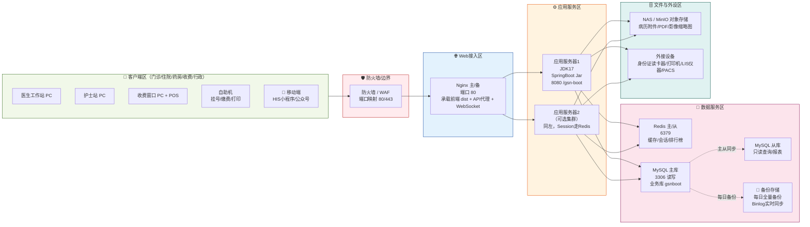

***

### 2.1 环境要求

#### 2.1.1 硬件要求（推荐）

| 服务器 | CPU | 内存 | 硬盘 | 用途 |
| :------- | :-- | :---- | :-------- | :---------------------- |
| 应用服务器 | 8核+ | 16GB+ | 200GB SSD | 后端Spring Boot + 前端Nginx |
| 数据库服务器 | 8核+ | 32GB+ | 500GB SSD | MySQL/达梦8 |
| Redis服务器 | 4核+ | 8GB+ | 50GB | 缓存与会话 |

#### 2.1.2 软件环境

| 软件 | 版本要求 | 说明 |
| :------ | :-------------------------------------------- | :-------------- |
| 操作系统 | Windows Server 2019+ / CentOS 7+ / Ubuntu 20+ | 支持Linux/Windows |
| JDK | OpenJDK 17 / Oracle JDK 17 | 必须17+ |
| Node.js | 20.15.0+ | 仅构建前端时需要 |
| pnpm | 8.x+ | 前端包管理 |
| MySQL | 5.7.36+ 或 8.0.27+ | 字符集 utf8mb4 |
| Redis | 5.0+ | 缓存与Session共享 |
| Nginx | 1.18+ | 前端静态资源+反向代理 |
| Maven | 3.6+ | 后端打包（构建机需要） |

### 2.2 数据库初始化

#### 2.2.1 创建数据库

```sql
-- MySQL 5.7/8.0
CREATE DATABASE IF NOT EXISTS gsnboot
 DEFAULT CHARACTER SET utf8mb4
 DEFAULT COLLATE utf8mb4_general_ci;
```

> 如果使用 **达梦8**，请使用 `his_insurance_dm8.sql` 对应脚本；金仓8请参考官方文档。

#### 2.2.2 执行SQL脚本顺序

数据库脚本位置：`Boot/gsn-boot/db/` 和 `Boot/gsn-boot/gsn-boot-module/gsn-module-his/db/`

**执行顺序严格按照以下步骤：**

| 序号 | 脚本文件 | 说明 | 是否必须 |
| :- | :------------------------------------------------------------------------------------------- | :-------------------------------------------------------------------- | :------ |
| 1 | `db/gsnboot-mysql-5.7.sql` | gsnBoot平台基础表（用户/权限/菜单/字典/在线表单/报表/定时任务等116张表） | ✅ 必须 |
| 2 | `gsn-boot-module/gsn-module-his/db/his_insurance_mysql.sql` | HIS医保增量字段（cm\_registration/cm\_cost/cm\_cost\_balance医保字段+医保开关参数） | 启用医保时必须 |
| 3 | `db/tables_xxl_job.sql` | XXL-Job分布式任务调度表（如果使用独立XXL-Job） | 可选 |
| 4 | `db/tables_nacos.sql` | Nacos配置中心表（微服务模式） | 可选 |
| 5 | `gsn-boot-module/gsn-module-tencent-meeting/src/main/resources/websocket_meeting_tables.sql` | 腾讯会议会诊表 | 可选 |
| 6 | Flyway自动迁移脚本 | `gsn-system-start/src/main/resources/flyway/sql/mysql/*.sql`（启动时自动执行） | 自动 |

> **重要**：启动应用时 Flyway 会自动执行未运行过的迁移脚本，**切勿手动修改** **`flyway_schema_history`** **表**。

#### 2.2.3 数据库配置

修改配置文件：`Boot/gsn-boot/gsn-module-system/gsn-system-start/src/main/resources/application-dev.yml`

```yaml
spring:
 datasource:
 dynamic:
 datasource:
 master:
 url: jdbc:mysql://127.0.0.1:3306/gsnboot?useUnicode=true&characterEncoding=utf8&useSSL=false&serverTimezone=Asia/Shanghai&tinyInt1isBit=false
 username: root
 password: your_password
 driver-class-name: com.mysql.cj.jdbc.Driver
 # Redis缓存
 redis:
 host: 127.0.0.1
 port: 6379
 password:
 database: 0
 timeout: 3000ms
```

### 2.3 后端部署

#### 2.3.1 Maven打包

```bash
cd Boot/gsn-boot

# 跳过测试打包
mvn clean package -Dmaven.test.skip=true

# 产物位置
# gsn-module-system/gsn-system-start/target/gsn-system-start-3.8.0.jar
```

#### 2.3.2 启动后端服务

```bash
# 生产环境启动（指定prod配置）
java -jar -Xms2048m -Xmx4096m \
 -Dfile.encoding=UTF-8 \
 -Dspring.profiles.active=prod \
 gsn-system-start-3.8.0.jar
```

后端默认端口 **8080**，上下文路径 `/gsn-boot`，访问地址：

- API地址：`http://<服务器IP>:8080/gsn-boot/`
- Knife4j文档：`http://<服务器IP>:8080/gsn-boot/doc.html`
- Druid监控：`http://<服务器IP>:8080/gsn-boot/druid/`（默认账号 admin/123456）

#### 2.3.3 注册为Windows服务（可选）

推荐使用 **winsw** 或 **NSSM** 将jar包注册为Windows服务，实现开机自启。

### 2.4 前端部署

#### 2.4.1 开发环境配置

修改前端配置文件 `vue/.env.development`：

```bash
# 接口代理，指向后端服务
VITE_PROXY = [["/gsnboot","http://localhost:8080/gsn-boot"],["/upload","http://localhost:3300/upload"]]
# 接口域名
VITE_GLOB_DOMAIN_URL=http://localhost:8080/gsn-boot
```

#### 2.4.2 前端本地调试

```bash
cd vue

# 安装依赖（首次运行）
pnpm install

# 启动开发服务器
pnpm dev
```

访问 `http://localhost:3100/` （默认端口见 vite.config.ts）

#### 2.4.3 生产构建与部署

```bash
cd vue

# 构建生产包
pnpm build

# 构建产物在 vue/dist/ 目录
# 将 dist 目录内容复制到 Nginx 的 html 目录下
```

Nginx配置示例（`nginx.conf`）：

```nginx
server {
 listen 80;
 server_name his.example.com;
 
 # 前端静态资源
 location / {
 root html;
 index index.html index.htm;
 try_files $uri $uri/ /index.html;
 }
 
 # 后端API反向代理
 location /gsnboot/ {
 proxy_pass http://127.0.0.1:8080/gsn-boot/;
 proxy_set_header Host $host;
 proxy_set_header X-Real-IP $remote_addr;
 proxy_set_header X-Forwarded-For $proxy_add_x_forwarded_for;
 # 文件上传大小
 client_max_body_size 50m;
 }
 
 # WebSocket代理（积木报表、实时消息等）
 location /gsnboot/websocket {
 proxy_pass http://127.0.0.1:8080/gsn-boot/websocket;
 proxy_http_version 1.1;
 proxy_set_header Upgrade $http_upgrade;
 proxy_set_header Connection "upgrade";
 }
}
```

### 2.5 启动顺序总览

```mermaid
gantt
 title HIS 系统启动顺序（甘特图）
 dateFormat HH:mm
 axisFormat %H:%M
 section 基础服务
 1. 启动 Redis :active, a1, 00:00, 2m
 2. 启动 MySQL :active, a2, after a1, 3m
 section 应用服务
 3. 启动后端 Boot Jar :active, b1, after a2, 5m
 4. 启动 Nginx :active, b2, after b1, 1m
 section 验证访问
 5. 浏览器验证 :crit, c1, after b2, 1m
```

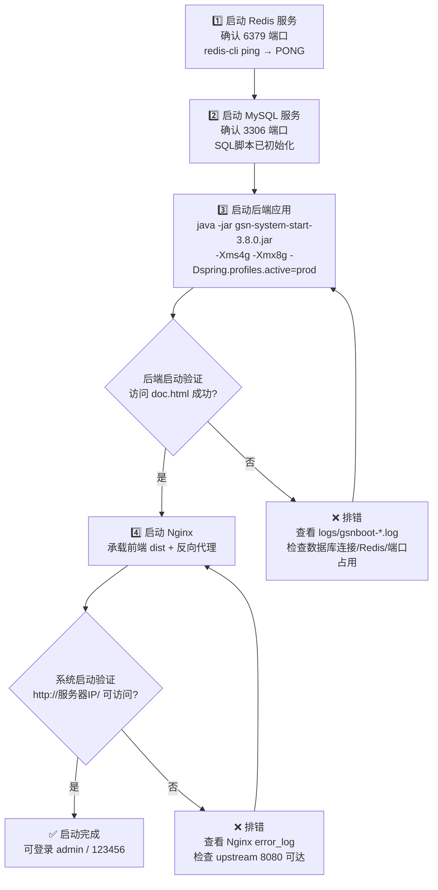

**最简文本版快速参考：**

```
1. 启动 Redis 服务
2. 启动 MySQL 服务（确认库表已初始化）
3. 启动后端：java -jar gsn-system-start-3.8.0.jar
4. 启动 Nginx（承载前端 dist + 反向代理）
5. 浏览器访问：http://<服务器IP>/ （Nginx 80端口）
```

### 2.6 默认账号

| 账号 | 密码 | 角色 | 说明 |
| :------ | :------- | :---- | :------------- |
| `admin` | `123456` | 超级管理员 | 系统管理员，拥有全部菜单权限 |
| `gsn` | `123456` | 普通管理员 | 示例管理员 |

> 首次登录后请立即修改默认密码，并在"系统管理→用户管理"中按医院实际情况创建账号、分配角色与部门。

***

## 3 数据库设计说明

***

### 3.1.1 系统数据流全景图

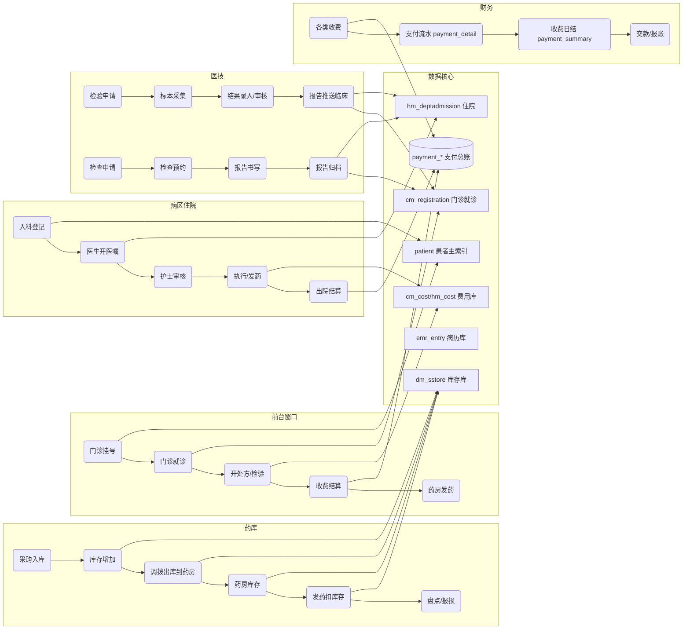

### 3.1.2 文字版实体关联说明

系统整体数据模型以 **患者（patient）** 为核心，围绕 **门诊就诊（cm\_registration）** 与 **住院就诊（hm\_deptadmission 等）** 两大业务主线展开。

```
核心实体关系（文字ER）：

┌─────────────┐ ┌──────────────────┐ ┌───────────────────┐
│ sys_user │1─────*│ cm_registration │*─────1│ patient │
│ (操作用户) │ │ (门诊挂号/就诊) │ │ (患者主索引) │
└─────────────┘ └────────┬─────────┘ └─────────┬─────────┘
 │ │
 │1 │1
 │* │*
┌──────────────┐ ┌─────────────────┐ ┌───────────────────┐
│ sys_depart │1─────*│ cm_cost │*─────1│ cm_patient_archive│
│ (科室部门) │ │ (门诊费用明细) │ │ (门诊病案归档) │
└──────────────┘ └────────┬─────────┘ └───────────────────┘
 │1
 │*
┌──────────────────┐ ┌──────────────────┐ ┌──────────────────────┐
│ hm_deptadmission │*──1│ cm_cost_balance │ │ common_icd / icd │
│ (住院入科登记) │ │ (门诊收费结算) │ │ (ICD诊断编码字典) │
└────────┬─────────┘ └──────────────────┘ └──────────────────────┘
 │1
 │*
┌─────────────────┐ ┌─────────────────┐ ┌──────────────────────┐
│ hm_drugadvice │ │ hm_cureadvice │ │ hm_payment_detail │
│ (住院药品医嘱) │ │ (住院诊疗医嘱) │ │ (住院支付明细) │
└────────┬────────┘ └────────┬────────┘ └──────────┬───────────┘
 │1 │1 │1
 │* │* │*
┌─────────────────┐ ┌─────────────────┐ ┌──────────────────────┐
│ hm_druglist │ │ advice_item │ │ payment_summary │
│ (住院发药明细) │ │ (医嘱项目明细) │ │ (支付汇总单) │
└─────────────────┘ └─────────────────┘ └──────────────────────┘

药品与耗材链：
┌───────────────┐ ┌──────────────┐ ┌────────────────────┐
│ dm_drug_info │1─────*│ dm_sin │ │ dm_sout │
│ (药品字典/目录)│ │ (药品入库单) │ │ (药品出库/调拨单) │
└───────────────┘ └──────┬───────┘ └────────────────────┘
 │1
 │*
 ┌──────────────┐
 │ dm_sstore │
 │ (药品实时库存)│
 └──────────────┘

电子病历链：
┌──────────────────────┐ ┌──────────────────────┐
│ emr_catalog（病历目录）│1─────*│ emr_entry（病历录入） │
└──────────────────────┘ └──────────┬───────────┘
 │1
 │*
 ┌──────────────────────┐
 │ emr_qc_record（质控记录）│
 └──────────────────────┘

LIS检验链：
┌──────────────────┐ ┌──────────────────┐ ┌────────────────────┐
│ lis_assay_item │1─────*│ lis_specimen │*─────1│ lis_specimen_result│
│ (检验项目字典) │ │ (检验标本) │ │ (标本检验结果) │
└──────────────────┘ └──────────────────┘ └────────────────────┘
```

**关联说明**：

- 所有业务表均通过 `create_by` 关联 `sys_user.id`（创建人）
- 所有业务表均通过 `depart_id` 或 `dept_code` 关联 `sys_depart`（科室）
- 多租户场景下通过 `tenant_id` 字段隔离医院/机构数据
- 费用类表（cm\_cost、hm\_cost、payment\_detail 等）通过 `registration_id` 或 `inpatient_id` 关联就诊主记录
- 医嘱类表（cm\_drugadvice、hm\_drugadvice 等）通过 `advice_id` 关联执行/发药明细

## 4 业务操作流程

### 4.1 门诊业务全流程

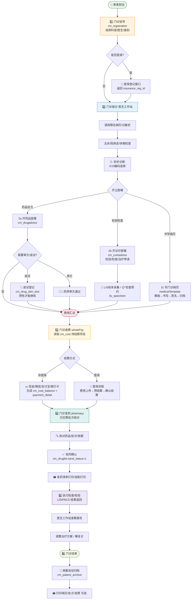

**操作要点**：

- 挂号时患者不存在可直接新建患者档案（patient表）
- 收费支持"一次就诊多次结算"（部分缴费模式）
- 退号/退费必须走审批流程（cm\_cost\_back\_apply）
- 皮试阳性药品会自动拦截，禁止发药

***

### 4.2 住院业务全流程

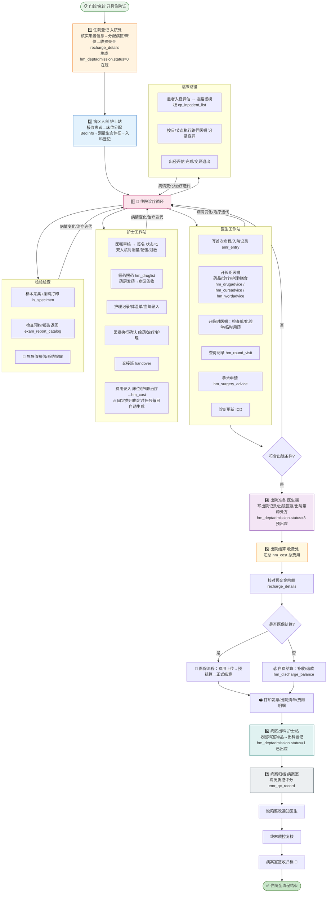

**操作要点**：

- 医嘱审核后才可发药/执行；停止医嘱必须经双人复核
- 床位费、空调费等固定费用由定时任务（BedFixFareTask）每日自动生成
- 住院预交金不足时系统弹窗提醒护士/医生；透支额度在 sys\_bs\_parmeter 中配置
- 转科操作涉及 hm\_deptadmission 记录变更、床位释放与新床位占用、费用归属调整

***

### 4.3 药房药库业务流程

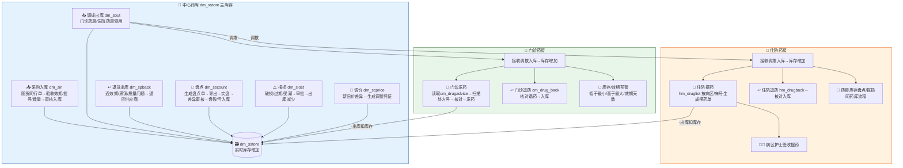

***

### 4.4 检验LIS业务流程

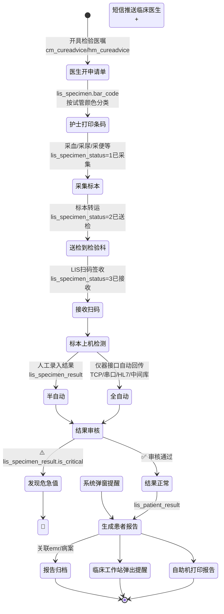

***

### 4.5 收费结算业务流程

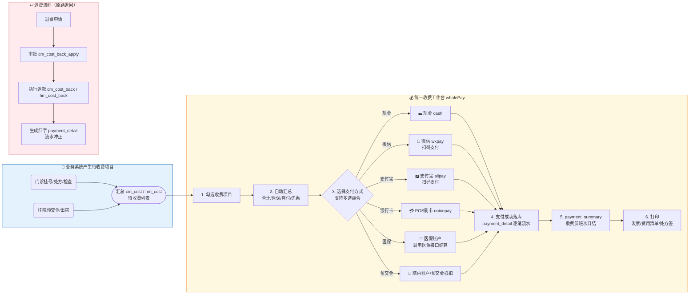

***

### 4.6 电子病历质控流程

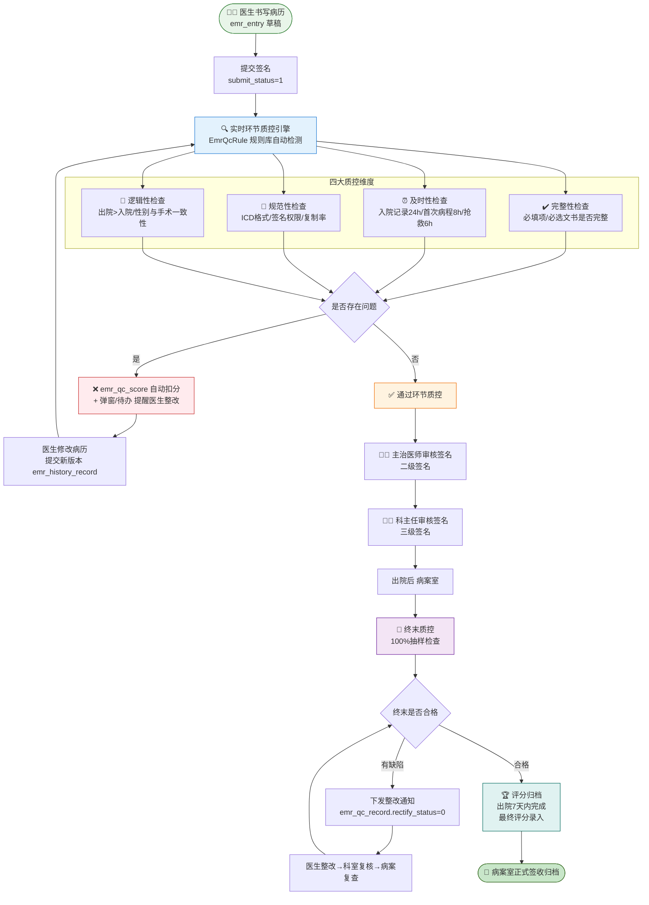

***

## 5 功能模块说明

### 5.0 核心业务状态机总览

> 以下状态机帮助操作者理解各模块关键数据在业务流转中的状态变化（对应各表 status 字段）。

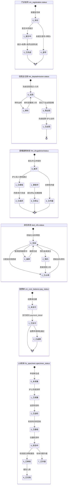

***

### 5.1 工作台首页（homes/）

| 页面 | 路径 | 功能说明 | 适用角色 |
| :---- | :---------------------------------- | :----------------------------------------- | :------- |
| 综合工作台 | homes/mainHome | 全院总览：今日挂号/出院/在院人数、药库库存告警、收费金额趋势、病床使用率、待办任务 | 院领导/行政 |
| 医生工作台 | homes/doctorHome、homes/doctorReport | 今日出诊信息、在院患者列表、待审医嘱、危急值提醒、未完成病历提醒、本周工作量统计 | 门诊/住院医生 |
| 护士工作台 | homes/nurseReport | 病区床位状态图、待执行医嘱、待测量体温、今日手术患者、新入患者、病危病重患者 | 病区护士长/护士 |
| 药房工作台 | homes/drugStore | 待发药处方列表（门诊/住院）、库存预警、效期预警、待盘点提醒、今日发药统计 | 药师/药库管理员 |
| 收费工作台 | homes/payHome | 今日收费笔数/金额（按支付方式）、未日结提醒、预交金余额不足预警、退费统计 | 收费员/收费主任 |
| 门诊工作台 | homes/cm | 门诊今日候诊队列、叫号提醒、门诊病历快捷入口、常用处方模板 | 门诊医生 |

### 5.2 门诊管理

#### 5.2.1 门诊挂号（cmRegistration）

- **列表查询**：按日期、科室、医生、挂号状态、患者姓名/就诊卡号多条件查询挂号记录
- **新增挂号**：
 - 老患者：输入身份证/就诊卡/姓名查询 patient 表，匹配后自动填充
 - 新患者：录入姓名、性别、出生、身份证、电话、地址等 → 自动生成 patient\_code
 - 选择就诊科室（sys\_depart）、就诊医生（sys\_user + 科室）、挂号级别（sys\_dict 字典：普通/专家/急诊/名老专家）
 - 显示挂号费、诊查费 → 提交（未收费为"待缴费"状态，交费后"待诊"）
- **退号**：未就诊的挂号记录可申请退号 → 收费处退费
- **转科**：已挂号未就诊患者可调整科室/医生
- **导出/打印**：导出挂号明细Excel、打印挂号小票

#### 5.2.2 门诊就诊（cm / cmSearch）

- **患者列表**：按科室、候诊状态（待诊/就诊中/已完成）列出当日就诊患者，支持叫号、优先插队
- **就诊详情**：
 - 患者基本信息卡：性别、年龄、过敏史、既往病史、近30天就诊史、近1年检验检查
 - 主诉、现病史、既往史、个人史、家族史（文本域）
 - 体格检查：T/P/R/BP、一般情况、专科检查（可配置模板）
 - 初步诊断：ICD编码选择（支持拼音/汉字搜索 common\_icd、icd 表），多诊断主次排序
 - **开处方**：西药/中成药/中草药三Tab页；支持药品搜索（拼音码/商品名/通用名）、常用处方模板(commonlyUsed)、自动计算总量、配伍禁忌与过敏史提醒
 - **开检查/检验**：检索 diagnosis\_project\_data 项目，填写数量→生成 cm\_cureadvice
 - **写病历**：跳转 medicalTemplate 富文本编辑器
- **病历查询**（cmSearch）：跨时间查询历史门诊病历，支持条件：患者、诊断、时间段、科室、医生

#### 5.2.3 门诊收费结算（cmCostBalance / pay/wholePay）

- **待收费列表**：按患者维度汇总"已开立未收费"项目（处方、检验检查、治疗）
- **收费详情**：
 - 左侧：费用项目清单（可勾选部分缴费），显示单价/数量/金额/医保类别（甲类/乙类/自费）
 - 右侧：收费信息：合计金额、优惠、应收、支付方式组合、实收、找零
 - 微信/支付宝：生成二维码 → 扫码成功自动返回支付结果
 - 医保：选择医保结算 → 读取医保支付/自付/自费明细 → 确认结算
- **结算查询**：结算单号、发票号、日期、患者、金额、支付方式、状态、收费员
- **退费管理**：找到已结算单 → 申请退费 → 填写原因 → 审批 → 原路退款（现金退现金、扫码退原账户、医保撤销结算）

#### 5.2.4 门诊发药（pharmacy / pharmacyMed）

- **待发药列表**：按收费时间倒序显示已交费未发药的处方；支持处方号/患者姓名/就诊卡号快速检索
- **发药详情**：
 - 患者信息卡 + 处方信息（医生/科室/时间/处方类型）
 - 药品清单：药品名/规格/数量/批号/效期/用法用量
 - 核对后点击"发药确认"→ cm\_druglist.send\_status=1，库存减少
 - "发药清单打印"：患者取药凭据
- **退药处理**（drugStore/goodsReturn）：凭退药申请单 → 核对药品 → 退药入库 → 退费关联

#### 5.2.5 皮试管理（drugSkinTest）

- 登记皮试患者、药品（青霉素、头孢等需皮试药品）
- 录入皮试结果：阴性/阳性/假阳性，附反应描述、照片
- 阳性结果自动拦截该患者后续同类药品处方与发药

### 5.3 住院管理（Inpatient/）

#### 5.3.1 住院登记与入出科

- **住院登记**（beHospitalized/register → HmInpatientController）：
 - 关联门诊就诊（可选）或直接新建；录入入院诊断、入院科室、主治医生、预交金
 - 自动生成住院号 inpatient\_no（sys\_sequence 自增）
- **病区入科**（Inpatient/inDept → HmDeptadmissionController）：
 - 入科时间、接收护士、分配床位、初步护理等级
 - 可批量入科（如早晨集中转病房）
- **病区出科**（Inpatient/outDept）：
 - 出科原因：出院/转科/死亡
 - 回收物品确认、费用预结算
- **转科转床**（wardTransfer / TransferController）：
 - 新科室/新床位选择；转科小结；费用自动归属调整

#### 5.3.2 医嘱管理（核心）

| 子模块 | 页面/Controller | 功能 |
| :--------- | :---------------------------------------------- | :------------------------------------------------------------------------------------------- |
| **开医嘱** | Inpatient/orderExe、doctorWork/orderExe | 长期/临时、药品/诊疗/护理/文字；支持成组医嘱、医嘱模板、常用医嘱套（cfTemplate）、协议处方（agreementPrescription/pkgAdviceSummary） |
| **医嘱审核** | Inpatient/orderExamine | 护士审核新开医嘱，核对药品剂量、配伍、过敏史；审核通过进入发药/执行环节，驳回需注明原因 |
| **药品医嘱发药** | Inpatient/sendMed → DrugAdviceSendController | 按病区/批次汇总摆药单 → 药房摆药 → 病区签收发药；支持"毒麻精放"双人复核 |
| **诊疗医嘱发送** | Inpatient/sendCure → HmCureAdviceSendController | 向检验科/放射科/治疗科发送申请；支持接收回执 |
| **医嘱执行** | Inpatient/drugExe | 护士执行给药/治疗后签名确认，记录执行时间、执行人；输液可扫码执行（MtTransfusionController） |
| **退药** | Inpatient/drugReturn → HmDrugbackController | 未用完药品退药，填退药原因 |
| **护理医嘱** | Inpatient/nursingOrder → 护理记录单、护理项目配置、护理等级调整 | <br /> |

#### 5.3.3 体温单与护理

- **体温录入**（Inpatient/temperatures）：按班次（6:00/10:00/14:00/18:00/22:00/2:00）录入T/P/R/BP/血氧/入量/出量/大便次数/体重
- **体温单**（Inpatient/temperatureChart/Chart.vue）：基于Canvas绘制的三测单曲线，支持显示7-14天，可打印
- **护理记录**（nursing、NurseMasterRecordController）：一般护理记录、危重护理记录、手术护理记录
- **交接班**（handover）：白班/夜班交接；重点病人、新入、术后、病危；物品清点
- **输液管理**（infusion → MtTransfusionController）：输液卡打印、扫码核对、滴速记录、不良反应

#### 5.3.4 住院费用与结算

- **费用录入**（Inpatient/costEntry）：床位费、护理费、治疗费、材料费、手术费录入/批量录入
- **费用查询**（Inpatient/payInfo）：分类（西药/中药/检验/检查/治疗/材料/床位/护理/手术/其他）汇总、每日清单、费用详情
- **预交金充值**（prePay/PrepayController、rechargeDetails）：微信/支付宝/现金充值、充值记录查询
- **出院结算**（HmDischargeBalanceController、Inpatient/outPayInfo）：
 - 自动汇总总费用 → 扣除预交金 → 补收/退款
 - 医保结算、打印住院结算发票、费用总清单、出院医嘱单
- **补记账调整**（fixupdetail、BalancefareController）：出院后费用修正、收费员日结交款

### 5.4 药房药库管理（drugStore/）

| 子模块 | 页面/Controller | 功能要点 |
| :------- | :--------------------------------------------- | :--------------------------------------- |
| 药品字典维护 | baseData/drugDictionary → DmDrugInfoController | 西药/中成药/中草药目录；拼音码自动生成；医保属性、进价/零售价、库存/效期预警 |
| 药品入库 | drugStore/departTranfer（入库）、DmSinController | 采购入库、调拨入库、退货入库、盘盈入库；批次、批号、效期管理 |
| 药品出库/调拨 | DmSoutController、departTranfer | 药房领用出库、科室调拨、退货给供应商、报损出库 |
| 药品库存查询 | drugInventory、DrugInventoryController | 实时库存、批次、效期、锁定量；按库房/药品/批次/效期多条件 |
| 药品盘点 | drugStoreStock → DmSscountController | 生成盘点单→导出Excel→实物盘点→导入差异→审核生成盘盈/亏单据 |
| 药品报损 | drugLoss → DmSlostController | 报损单填报→审批→出库减少→财务留痕 |
| 药品调价 | drugPrice → DmScpriceController | 进价/零售价调整；计算库存调价盈亏；调价生效日期 |
| 药品退货给供应商 | goodsReturn → DmSpbackController | 近效期/滞销/质量问题退货；关联原入库单 |
| 进销存报表 | SPreport、DrugInventoryReport | 时间段内入/出/存汇总；按分类/药品/库房维度 |
| 药品货位 | location → DmLocationController | 库房-区域-货架-层 货位码；支持扫码上架 |
| 药品条码 | MedicineBarcodeController | 药品条形码打印、扫码入库/发药 |
| 药品标签 | DrugTagContentController | 药品说明书内容、警示、配伍禁忌内容维护 |

### 5.5 耗材管理（mt/）

- **耗材目录**（mcDictionary → McDictionaryController）：高值耗材/低值耗材/植入耗材分类维护，支持注册证号、效期预警
- **入库**（mtInbound → McSinController）、**出库**（mtOutbound → McSoutController）：与药品模式相同
- **盘点**（mtStock → McSscountController）、**报损**（mtLoss → McSlostController）、**退货**（mtReturn → McSpbackController）
- **库存查询**（mtInventory → McInventoryController）
- **耗材报表**（mtList）：高值耗材溯源追踪（病人→批号→供应商全链路）

### 5.6 电子病历（medicalTemplate / medicalTemplateZy）

- **富文本编辑器**（ThinkEditor）：
 - 支持结构化元素（勾选项、下拉、日期、签名区）
 - 支持 ICD诊断插入、检验检查报告引用、历史病历复制
 - 支持表格、图片上传、痕迹保留（谁改了什么）
- **病历模板**（emrTemplate、EmrCatalogController）：
 - 按科室/医生/公共维度管理入院记录、病程、手术、出院、护理等模板
 - 模板分类树；支持模板权限（谁可用此模板）
- **门诊病历**（medicalTemplateList）：主诉/现病史/查体/诊断/处理/处方一站式
- **住院病历**（medicalTemplateZy）：入院记录、24h入出院、首次病程、日常病程、上级医师查房、交接班、转科、抢救、术前讨论、手术记录、术后病程、出院记录、死亡病例讨论
- **中医病历**（EmrZhTemplet/EmrZhRecord）：四诊信息、辨证论治、方剂、中医处方、针灸穴位
- **病历质控**（qualityControl/*、emrQc*系列Controller）：质控规则、质控记录、评分项、任务监控、病案首页质控

### 5.7 病案管理

| 子模块 | 页面/Controller | 功能 |
| :--- | :-------------------------------------------- | :------------------------ |
| 门诊病案 | patientArchive → CmPatientArchiveController | 门诊病历+处方+检查检验报告打包归档；借阅记录 |
| 住院病案 | ipPatientArchive → IpPatientArchiveController | 住院全病历+体温单+医嘱单+手术单+病理报告等归档 |
| 病案打印 | patientArchivePrint、ipPatientArchivePrint | 病案续打、按目录批量打印、自定义打印模板 |
| 病案借阅 | EmrRecordBorrowController | 借阅申请→审批→出库/归还→逾期提醒 |
| 病案审阅 | EmrRecordsStatusController | 住院病历/门诊病历完成率监控、病历超期预警 |

### 5.8 检验LIS（lis/\*）

- **检验项目字典**（AssayItemController）：维护全院检验项目、参考值、单位、价格、危急值、组合项目
- **检验标本**（LisSpecimenController）：
 - 标本采集（生成条码）、接收、拒收
 - 标本状态流转：采集→送检→接收→检验中→已审核→已报告
 - 急查标本高亮显示
- **标本结果**（LisSpecimenResultController）：
 - 定性/定量结果录入
 - 历史结果对比曲线
 - 异常（↑↓H L）与危急值（!!）自动标色
 - 审核通过后自动推送至临床医生工作站
- **仪器设备管理**（EquipmentController）：检验设备通信参数配置、状态监控、项目仪器比对
- **报告模板**（ResultTemplateController）：结果描述常用模板、细菌药敏模板
- **患者检验报告**（LisPatientResultController）：合并多标本报告、打印检验报告单

### 5.9 检查报告（examReport/\*）

- **检查目录管理**（ExamReportCatalogController）：报告类型、模板、检查部位、费用
- **报告文件管理**（ExamReportFileController）：DICOM、JPG、PDF等文件上传与存储
- **报告归档**（ExamReportArchiveController）：检查报告与病案关联归档
- **PACS集成**：通过URL跳转第三方PACS浏览器查看DICOM影像

### 5.10 收费支付（pay/、支付相关Controller）

- **统一收费工作台**（pay/wholePay → PaymentDetailController）：门诊/住院全场景统一收费页面
- **收费流水**（pay/medProcess）：每笔收费实时流水、撤销、重打小票
- **退费管理**（pay/refund → CmCostBalanceBack/CmCostBackApply）：退费申请与审批流
- **支付汇总**（PaymentSummaryController）：收费员日结、交班汇总、科室汇总
- **交款管理**（Balancefare/BalanceinfoController）：收费员班次交接、缴款凭证
- **医保对接**（insurance/\*）：
 - 门诊/住院医保登记（获取就诊ID）
 - 门诊/住院费用明细上传（逐条或批量）
 - 医保预结算（试算报销比例与自付）
 - 医保正式结算（锁定费用、生成医保结算单）
 - 医保撤销结算（当日取消）
 - 医保对账（MiDailyReconciliationController）：HIS与医保中心每日对账

### 5.11 临床路径（pathWay/）

- **路径模板管理**（pathManager → CpPathInfo/CpPathNode/CpPathLink/CpPathOrder）：
 - 路径元数据：ICD适用、标准住院日、费用范围
 - 节点编辑：流程图拖拽（JointJS/LiteFlow），入院-术前-术中-术后-出院阶段
 - 节点医嘱：每节点标准药品/诊疗/护理医嘱（必选/可选）
- **入径管理**（inpatientList → CpInpatinetListController）：
 - 住院患者入径评估（ICD匹配、排除标准）
 - 入径后每日按路径生成建议医嘱
 - 变异记录：增加/减少/修改医嘱的原因
 - 出径：完成或退出路径（附原因）

### 5.12 质控管理（qualityControl/）

- **终末质控**（endControl、EmrQcRecord）：出院后病案评分、问题整改
- **医嘱质控**：不合理用药、超剂量、重复用药、禁忌症等拦截
- **过程质控**（QaTaskMonitor）：病历书写时效、签名时效监控
- **质控规则维护**（EmrQcRule）：新增/编辑质控规则、规则表达式
- **质控评分项**（EmrQcScoreDirectory、EmrQcScoreItem）：评分维度/要点维护
- **质控评分**（EmrQcScore、EmrQcScoreRecord）：医师评分与复核记录

### 5.13 基础数据

| 子模块 | 页面/Controller | 功能 |
| :------ | :------------------------------------------ | :----------------------------------- |
| 患者信息 | patient → PatientController | 患者CRUD、批量导入、患者合并（去重）、标签管理 |
| 患者标签 | patientTag、patientTagRule | 标签规则引擎（SQL/表达式）、自动打标（糖尿病/高血压/老年/儿童等） |
| ICD编码 | IcdController、CommonIcdController | ICD-10/ICD-11诊断、手术操作编码；医生常用ICD收藏 |
| 诊疗项目 | baseData/diagnosis/\* | 检查/检验/治疗/手术项目字典、项目分类、组合项目 |
| 药品字典 | DmDrugInfoController | 见5.4 |
| 耗材字典 | McDictionaryController | 见5.5 |
| 供应商 | baseData/provider → ProviderController | 证照有效期、分级、资质管理 |
| 行政区划 | baseData/region → SysRegionController | 省/市/区/街道四级联动字典 |
| 员工信息 | HisSysUserController、Employee、HisExpertWall | 员工基本信息、排班、职称、专家介绍 |
| 业务参数 | SysBsParmeterController | HIS关键参数：是否启用医保、透支额度、皮试默认20分钟、票据号前缀等 |
| 自增编码 | SelfIncrementCodeController | 挂号号、住院号、结算单号等单据编码规则配置 |
| 国家/民族字典 | SysCountryController | 维护国家、民族字典数据 |

### 5.14 AI医疗助手（medicalAi/MedicalAiController）

- **AI问诊对话**（MedicalAiChat.vue）：基于大模型的症状分析、问诊建议、鉴别诊断
- **病历AI生成**：根据主诉、查体、检验检查自动生成病历草稿，医生审核修改
- **智能诊断推荐**：根据病症输入推荐ICD诊断Top-N
- **AI会话记录**（MedicalAiSession）：留存对话历史，支持追溯

### 5.15 系统管理（sys/\*，gsnBoot原生）

- **用户管理**：sys\_user → 用户CRUD、重置密码、分配角色/部门
- **角色管理**：sys\_role → 角色CRUD、分配菜单权限、数据权限规则
- **部门管理**：sys\_depart → 医院-分院-科室-病区-班组 组织树
- **菜单管理**：sys\_permission → 菜单树、按钮级权限标识、前端路由生成
- **字典管理**：sys\_dict / sys\_dict\_item → 挂号级别、性别、结算类型等所有下拉字典
- **系统参数**：sys\_bs\_parmeter（HIS业务参数）+ gsn系统参数
- **定时任务**：sys\_quartz\_job → 床位费日结、病案提醒、库存预警、数据同步等Cron任务
- **操作日志**：sys\_log → 所有增删改查操作留痕
- **数据日志**：sys\_data\_log → 关键字段新旧值对比（审计）
- **积木报表**：HisJiMuReport\* 系列 → 报表设计、报表数据源、报表权限
- **积木报表代理**：jimuReport/ProxyController → 集成报表在HIS内部页面访问
- **多租户管理**：sys\_tenant → 多医院/多院区数据隔离

### 5.16 会议会诊（tencent-meeting/）

- 快速创建视频会诊会议 → 邀请院内专家/外院专家
- 会议列表、我的会议、会议密码/链接分享
- 会议记录与复诊预约

### 5.17 其他特色模块

- **专家墙/名片**（expertCard、HisExpertWallController）：科室专家介绍、出诊时间表、预约入口
- **诊疗手册**（zlsc）：疾病临床路径+诊疗方案查阅（知识库）
- **交接班**（handover）：病区交接班记录本
- **用血管理**（mtTransfusion）：输血申请、血袋信息、输血记录、不良反应
- **疾病风险评估**（DiseaseRiskAssessment）：患者病情评分、分级护理建议
- **协议处方**（agreementPrescription、pkgAdviceSummary）：常见病处方协议套餐（如高血压标准处方）
- **院长决策看板**（InpatientDashboard、DashboardController）：床位使用率、门诊量趋势、收入结构、药占比、耗占比、平均住院日、手术量

***

### 5.18 常见故障快速排查决策树（前置FAQ辅助）

> 在查阅FAQ前，建议先使用下面的决策树快速定位问题类别。

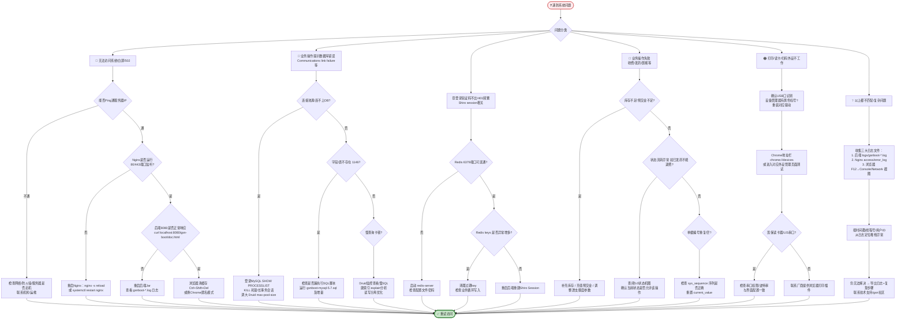

***

## 6 常见问题（FAQ）

### 6.1 部署与启动类

**Q1：启动后端报错：`Communications link failure`** **或** **`Unable to get connection`？**

> 通常是MySQL未启动、IP/端口/账号密码错误、防火墙拦截。请检查 `application-dev.yml` 的 `spring.datasource.dynamic.datasource.master` 配置，并确认 MySQL 3306端口可连通：
>
> ```bash
> # Windows PowerShell
> Test-NetConnection 127.0.0.1 -Port 3306
> ```

**Q2：报错：`Caused by: redis.clients.jedis.exceptions.JedisConnectionException`**

> Redis未启动或配置错误。请启动 Redis 服务（默认端口6379，默认无密码）。如Redis有密码，需在 `application-dev.yml` 中填写 `spring.redis.password`。

**Q3：前端访问提示跨域 / 登录后401/403？**

> 请检查前端 `.env.development` 的 `VITE_PROXY` 与 `VITE_GLOB_DOMAIN_URL` 是否正确指向后端地址；生产环境请使用Nginx反向代理 `/gsnboot/` 路径到后端 `/gsn-boot/`。

**Q4：前端页面打开空白、控制台报错** **`chunk load failed`？**

> 生产环境多为Nginx缓存未清理：
>
> ```
> # 清浏览器硬缓存：Ctrl+F5
> # 或重启 Nginx：nginx -s reload
> ```
>
> 若仍不行，删除 dist 重新 pnpm build。

**Q5：启动时 Flyway 报错** **`Validate failed: migration checksum mismatch`**

> **禁止手动修改数据库中 flyway\_schema\_history 表记录**。正确做法：
>
> 1. 先确认迁移脚本没被改过；
> 2. 如果开发期确认无问题，可以在 `application-dev.yml` 临时设置 `spring.flyway.clean-disabled=false` 并手动清理库（生产环境绝对禁止）。

### 6.2 登录与权限类

**Q6：默认账号 admin / 123456 登录失败？**

> 请检查数据库 `sys_user` 表是否存在 admin 记录：
>
> ```sql
> SELECT username, password, salt, status, del_flag FROM sys_user WHERE username='admin';
> ```
>
> status=1(启用)、del\_flag=0(未删除)。如果密码被改，可重置：
>
> - gsnBoot提供重置密码接口或使用官方SQL脚本重新初始化 sys\_user 密码（密码规则：MD5(MD5(password)+salt)）。

**Q7：菜单不显示 / 点击菜单提示"无权限"？**

> 1. 登录用户是否分配了角色？
> 2. 角色是否勾选了对应菜单（sys\_role\_permission）？
> 3. 如果是按钮级权限，检查 Controller 方法 `@RequiresPermissions` 注解与角色"按钮权限"是否配置。

**Q8：多租户场景下，A医院能看到B医院数据？**

> 检查业务表是否存在 `tenant_id` 字段，以及当前登录用户的 `sys_user.tenant_id` 是否正确；MyBatis-Plus 租户拦截器会自动追加 `tenant_id` 条件。

### 6.3 门诊业务类

**Q9：挂号时提示"患者已存在"，找不到患者档案？**

> 请用身份证号或手机号精确查询 patient 表，可能患者在其他渠道已建档。支持"患者合并"功能去重。

**Q10：门诊处方发药时库存不足？**

> 1. 到 `药房药库→库存查询` 核实药品库存；
> 2. 若库存充足但显示不足，可能有"锁定库存lock\_qty"（有其他处方已占存未发药）；
> 3. 紧急情况下走药库→药房调拨流程补充库存。

**Q11：退号/退费无法操作？**

> 请确认该笔费用：
>
> - 未执行（如处方已发药则需先退药）；
> - 未做日结（日结后不能再直接退，须走红冲）；
> - 有审批权限（当前用户在 cm\_cost\_back\_apply 审批链中）。

### 6.4 住院业务类

**Q12：床位费/空调费某天缺失，没有自动生成？**

> 检查定时任务 `sys_quartz_job` 中"床位固定费日结任务（BedFixFareTask）"是否启用、上次执行是否成功；可手动执行一次补账。

**Q13：医嘱停不掉/删除不了？**

> 已审核并已执行的医嘱不允许直接删除，只能"停止医嘱"并注明停止原因；长期医嘱停止后次日不再生成费用。

**Q14：出院结算时费用对不上？**

> 通常是"费用漏记"或"未停止医嘱持续出费"。排查流程：
>
> 1. `费用录入`补记缺失费用；
> 2. 核查所有长期医嘱是否在预出院前全部停止（尤其是12:00节点停止避免多计一天）；
> 3. `hm_cost` 汇总 vs `hm_discharge_balance` 差异；
> 4. 差异通过 `fixupdetail` 调整单修正。

**Q15：患者转科后，费用仍归属原科室？**

> 转科操作（TransferController）会触发费用归属批量重算；若发现漏网数据，可在费用详情中手动调整 `hm_cost.dept_id`。

### 6.5 药房药库类

**Q16：盘点后差异特别大？**

> 1. 确认盘点单生成后没有继续出入库（应锁库盘点）；
> 2. 检查是否所有批次/货位都已盘点；
> 3. 差异大于阈值时建议二次复盘。

**Q17：同种药品有多个批次，发药先出哪个？**

> 系统默认 **FEFO（先效期先出）**，在 SysBsParmeter 中可改为 FIFO（先进先出）。发药时可人工选择批次。

**Q18：药品效期预警，但库房没有显示？**

> 核对 dm\_drug\_info.expiry\_alert\_days（如设为90天，提前90天预警）；检查后台定时任务是否扫描 dm\_sstore.expiry\_date 并写入告警表。

### 6.6 LIS检验类

**Q19：仪器结果回传失败？**

> 1. Ping 仪器IP + 端口（实验室VLAN是否通）；
> 2. 查看 equipment.communication\_mode / interface\_config 是否配置正确；
> 3. 开启检验接口调试日志；
> 4. 检查仪器侧是否开启"自动发送"模式。

**Q20：危急值发出后，医生未收到短信？**

> - sys\_sms 查看短信记录发送状态；
> - 检查 application-dev.yml 中 `spring.mail` 或第三方短信通道配置（如阿里云 DySms）是否开启；
> - 医生手机号 sys\_user.phone 是否为空。

### 6.7 电子病历类

**Q21：病历签名签不上？**

> 1. 当前登录用户必须是病历书写人本人或上级；
> 2. 用户是否有"病历签名"权限；
> 3. 签名插件/H5手写板组件是否正确加载。

**Q22：提交病历时"病历超过书写时限"被质控扣分？**

> 规则在 emr\_qc\_rule 表中可调整时限（例如"入院记录>24小时"）；确属特殊原因可由科主任/质控科手工豁免扣分。

**Q23：富文本编辑器图片粘贴不显示？**

> 可能是文件上传超过 `spring.servlet.multipart.max-file-size`（默认10MB），或 OSS/MinIO 未配置，上传接口 `/sys/common/upload` 请单独调试。

### 6.8 医保接口类

**Q24：医保结算报错：`9999 系统异常`** **或** **`签名失败`？**

> 国家医保SDK鉴权问题排查顺序：
>
> 1. 医保专网是否连通（ping 医保前置机IP）；
> 2. 加密机/医保读卡器是否正常；
> 3. 机构编码、操作员编码、定点医药机构编号 sys\_bs\_parmeter 配置；
> 4. 核对 his\_insurance\_enabled=1 以及医保支付编码。

**Q25：HIS与医保对账不平？**

> 使用 MiDailyReconciliationController 日对账功能，逐条比对：
>
> - HIS 结算单号 vs 医保 setl\_id
> - HIS 金额 vs 医保返回金额
> 差异通常是"断网导致HIS成功但医保未收到"，需走医保单边撤销或补传。

### 6.9 报表与打印类

**Q26：发票/费用清单打印格式不对？**

> 模板在积木报表 `jimu_report` 表中维护（如门诊收费发票、住院结算单），可通过积木报表设计器在线修改。

**Q27：体温单显示空白或曲线不完整？**

> 通常是录入数据跨日期断点；建议至少连续录入3天数据再查看曲线。可使用 `温度补录` 功能补历史数据。

### 6.10 性能与运维类

**Q28：系统卡顿慢，尤其早上 8:00-9:00？**

> 这是HIS典型高峰。排查与优化：
>
> 1. **数据库**：`show processlist` 看慢SQL → Druid `slow-sql-millis=5000` 记录的慢查询 → 建联合索引；
> 2. **Redis**：命中率是否>95%；热点数据（字典、菜单、用户信息）是否走缓存；
> 3. **后端JVM**：建议 -Xms4g -Xmx8g + G1 垃圾回收；
> 4. **Nginx**：启用 gzip、静态资源缓存、keepalive；
> 5. **横向扩展**：应用服务器多实例 + Nginx 负载均衡；
> 6. **数据库**：读写分离 / MySQL 主从。

**Q29：日志报错：`Shiro session timeout`？**

> 调整 Shiro session 超时时间（默认 30min）：
> 在 ShiroConfig 中设置 `globalSessionTimeout`；或检查前端是否正确携带 token 请求。

**Q30：如何备份数据库？**

> ```bash
> # MySQL 定时冷备份（建议每日凌晨）
> mysqldump -uroot -p --single-transaction --routines --triggers gsnboot > gsnboot_$(date +%Y%m%d).sql
> # 同时备份 Redis RDB / AOF 文件
> ```
>
> 建议保留至少最近7天备份，每月至少一次恢复演练。

***

## 附录A：关键配置速查表

| 配置项 | 位置 | 默认值 | 说明 |
| :----------- | :-------------------------------------------------- | :----------------- | :------------------------------- |
| 后端端口 | application-dev.yml server.port | 8080 | - |
| 后端上下文 | servlet.context-path | /gsn-boot | - |
| MySQL主库 | spring.datasource.dynamic.datasource.master | 127.0.0.1:3306 | - |
| Redis 地址 | spring.redis.host:port | 127.0.0.1:6379 | - |
| Flyway 启用 | spring.flyway.enabled | true | 首次部署需true；生产clean-disabled必须true |
| 定时任务启动 | spring.quartz.auto-startup | true | - |
| 医保总开关 | sys\_bs\_parmeter bs\_key=his\_insurance\_enabled | 0（关） | 按租户配置，1=启用 |
| 医保支付编码 | sys\_bs\_parmeter bs\_key=his\_insurance\_pay\_code | MEDICAL\_INSURANCE | 与支付方式字典匹配 |
| 前端开发端口 | vue/vite.config.ts | 3100 | - |
| 前端接口代理 | .env.development VITE\_PROXY | /gsnboot→后端 | - |
| 文件上传大小 | spring.servlet.multipart.max-file-size | 10MB | - |
| Druid 监控账号密码 | spring.datasource.druid.stat-view-servlet | admin/123456 | **生产务必修改** |

***

*本手册基于 HIS v3.8.0 整理生成，如有功能迭代请以实际系统界面为准。*

 Apache License
 Version 2.0, January 2004
 http://www.apache.org/licenses/

 TERMS AND CONDITIONS FOR USE, REPRODUCTION, AND DISTRIBUTION

 1. Definitions.

 "License" shall mean the terms and conditions for use, reproduction,
 and distribution as defined by Sections 1 through 9 of this document.

 "Licensor" shall mean the copyright owner or entity authorized by
 the copyright owner that is granting the License.

 "Legal Entity" shall mean the union of the acting entity and all
 other entities that control, are controlled by, or are under common
 control with that entity. For the purposes of this definition,
 "control" means (i) the power, direct or indirect, to cause the
 direction or management of such entity, whether by contract or
 otherwise, or (ii) ownership of fifty percent (50%) or more of the
 outstanding shares, or (iii) beneficial ownership of such entity.

 "You" (or "Your") shall mean an individual or Legal Entity
 exercising permissions granted by this License.

 "Source" form shall mean the preferred form for making modifications,
 including but not limited to software source code, documentation
 source, and configuration files.

 "Object" form shall mean any form resulting from mechanical
 transformation or translation of a Source form, including but
 not limited to compiled object code, generated documentation,
 and conversions to other media types.

 "Work" shall mean the work of authorship, whether in Source or
 Object form, made available under the License, as indicated by a
 copyright notice that is included in or attached to the work
 (an example is provided in the Appendix below).

 "Derivative Works" shall mean any work, whether in Source or Object
 form, that is based on (or derived from) the Work and for which the
 editorial revisions, annotations, elaborations, or other modifications
 represent, as a whole, an original work of authorship. For the purposes
 of this License, Derivative Works shall not include works that remain
 separable from, or merely link (or bind by name) to the interfaces of,
 the Work and Derivative Works thereof.

 "Contribution" shall mean any work of authorship, including
 the original version of the Work and any modifications or additions
 to that Work or Derivative Works thereof, that is intentionally
 submitted to Licensor for inclusion in the Work by the copyright owner
 or by an individual or Legal Entity authorized to submit on behalf of
 the copyright owner. For the purposes of this definition, "submitted"
 means any form of electronic, verbal, or written communication sent
 to the Licensor or its representatives, including but not limited to
 communication on electronic mailing lists, source code control systems,
 and issue tracking systems that are managed by, or on behalf of, the
 Licensor for the purpose of discussing and improving the Work, but
 excluding communication that is conspicuously marked or otherwise
 designated in writing by the copyright owner as "Not a Contribution."

 "Contributor" shall mean Licensor and any individual or Legal Entity
 on behalf of whom a Contribution has been received by Licensor and
 subsequently incorporated within the Work.

 2. Grant of Copyright License. Subject to the terms and conditions of
 this License, each Contributor hereby grants to You a perpetual,
 worldwide, non-exclusive, no-charge, royalty-free, irrevocable
 copyright license to reproduce, prepare Derivative Works of,
 publicly display, publicly perform, sublicense, and distribute the
 Work and such Derivative Works in Source or Object form.

 3. Grant of Patent License. Subject to the terms and conditions of
 this License, each Contributor hereby grants to You a perpetual,
 worldwide, non-exclusive, no-charge, royalty-free, irrevocable
 (except as stated in this section) patent license to make, have made,
 use, offer to sell, sell, import, and otherwise transfer the Work,
 where such license applies only to those patent claims licensable
 by such Contributor that are necessarily infringed by their
 Contribution(s) alone or by combination of their Contribution(s)
 with the Work to which such Contribution(s) was submitted. If You
 institute patent litigation against any entity (including a
 cross-claim or counterclaim in a lawsuit) alleging that the Work
 or a Contribution incorporated within the Work constitutes direct
 or contributory patent infringement, then any patent licenses
 granted to You under this License for that Work shall terminate
 as of the date such litigation is filed.

 4. Redistribution. You may reproduce and distribute copies of the
 Work or Derivative Works thereof in any medium, with or without
 modifications, and in Source or Object form, provided that You
 meet the following conditions:

 (a) You must give any other recipients of the Work or
 Derivative Works a copy of this License; and

 (b) You must cause any modified files to carry prominent notices
 stating that You changed the files; and

 (c) You must retain, in the Source form of any Derivative Works
 that You distribute, all copyright, patent, trademark, and
 attribution notices from the Source form of the Work,
 excluding those notices that do not pertain to any part of
 the Derivative Works; and

 (d) If the Work includes a "NOTICE" text file as part of its
 distribution, then any Derivative Works that You distribute must
 include a readable copy of the attribution notices contained
 within such NOTICE file, excluding those notices that do not
 pertain to any part of the Derivative Works, in at least one
 of the following places: within a NOTICE text file distributed
 as part of the Derivative Works; within the Source form or
 documentation, if provided along with the Derivative Works; or,
 within a display generated by the Derivative Works, if and
 wherever such third-party notices normally appear. The contents
 of the NOTICE file are for informational purposes only and
 do not modify the License. You may add Your own attribution
 notices within Derivative Works that You distribute, alongside
 or as an addendum to the NOTICE text from the Work, provided
 that such additional attribution notices cannot be construed
 as modifying the License.

 You may add Your own copyright statement to Your modifications and
 may provide additional or different license terms and conditions
 for use, reproduction, or distribution of Your modifications, or
 for any such Derivative Works as a whole, provided Your use,
 reproduction, and distribution of the Work otherwise complies with
 the conditions stated in this License.

 5. Submission of Contributions. Unless You explicitly state otherwise,
 any Contribution intentionally submitted for inclusion in the Work
 by You to the Licensor shall be under the terms and conditions of
 this License, without any additional terms or conditions.
 Notwithstanding the above, nothing herein shall supersede or modify
 the terms of any separate license agreement you may have executed
 with Licensor regarding such Contributions.

 6. Trademarks. This License does not grant permission to use the trade
 names, trademarks, service marks, or product names of the Licensor,
 except as required for reasonable and customary use in describing the
 origin of the Work and reproducing the content of the NOTICE file.

 7. Disclaimer of Warranty. Unless required by applicable law or
 agreed to in writing, Licensor provides the Work (and each
 Contributor provides its Contributions) on an "AS IS" BASIS,
 WITHOUT WARRANTIES OR CONDITIONS OF ANY KIND, either express or
 implied, including, without limitation, any warranties or conditions
 of TITLE, NON-INFRINGEMENT, MERCHANTABILITY, or FITNESS FOR A
 PARTICULAR PURPOSE. You are solely responsible for determining the
 appropriateness of using or redistributing the Work and assume any
 risks associated with Your exercise of permissions under this License.

 8. Limitation of Liability. In no event and under no legal theory,
 whether in tort (including negligence), contract, or otherwise,
 unless required by applicable law (such as deliberate and grossly
 negligent acts) or agreed to in writing, shall any Contributor be
 liable to You for damages, including any direct, indirect, special,
 incidental, or consequential damages of any character arising as a
 result of this License or out of the use or inability to use the
 Work (including but not limited to damages for loss of goodwill,
 work stoppage, computer failure or malfunction, or any and all
 other commercial damages or losses), even if such Contributor
 has been advised of the possibility of such damages.

 9. Accepting Warranty or Additional Liability. While redistributing
 the Work or Derivative Works thereof, You may choose to offer,
 and charge a fee for, acceptance of support, warranty, indemnity,
 or other liability obligations and/or rights consistent with this
 License. However, in accepting such obligations, You may act only
 on Your own behalf and on Your sole responsibility, not on behalf
 of any other Contributor, and only if You agree to indemnify,
 defend, and hold each Contributor harmless for any liability
 incurred by, or claims asserted against, such Contributor by reason
 of your accepting any such warranty or additional liability.

 END OF TERMS AND CONDITIONS

 APPENDIX: How to apply the Apache License to your work.

 To apply the Apache License to your work, attach the following
 boilerplate notice, with the fields enclosed by brackets "[]"
 replaced with your own identifying information. (Don't include
 the brackets!) The text should be enclosed in the appropriate
 comment syntax for the file format. We also recommend that a
 file or class name and description of purpose be included on the
 same "printed page" as the copyright notice for easier
 identification within third-party archives.

 Copyright [yyyy] [name of copyright owner]

 Licensed under the Apache License, Version 2.0 (the "License");
 you may not use this file except in compliance with the License.
 You may obtain a copy of the License at

 http://www.apache.org/licenses/LICENSE-2.0

 Unless required by applicable law or agreed to in writing, software
 distributed under the License is distributed on an "AS IS" BASIS,
 WITHOUT WARRANTIES OR CONDITIONS OF ANY KIND, either express or implied.
 See the License for the specific language governing permissions and
 limitations under the License.

举报

举报成功

我们将于2个工作日内通过站内信反馈结果给你！

请认真填写举报原因，尽可能描述详细。

举报类型

请选择举报类型

举报原因

取消

发送

误判申诉

此处可能存在不合适展示的内容，页面不予展示。您可通过相关编辑功能自查并修改。

如您确认内容无涉及 不当用语 / 纯广告导流 / 暴力 / 低俗色情 / 侵权 / 盗版 / 虚假 / 无价值内容或违法国家有关法律法规的内容，可点击提交进行申诉，我们将尽快为您处理。

取消

提交

简介

医疗信息系统（Hospital Information System，简称 **HIS**）是基于低代码平台构建的企业级医院综合管理系统。系统覆盖医院从患者挂号、门诊就诊、住院诊疗、药房药库、检验检查、电子病历、收费结算到病案归档的全流程数字化管理，同时支持医保接口对接、耗材管理、临床路径、健康体检、质控评分、AI等扩展功能。

展开

收起

暂无标签

README

Apache-2.0

使用 Apache-2.0 开源许可协议

6

Stars

2

Watching

4

Forks

保存更改

取消

发行版

暂无发行版

贡献者

全部

语言

Java
80.2%

JavaScript
15.2%

CSS
3.5%

FreeMarker
0.8%

Fluent
0.3%

近期动态

加载更多

不能加载更多了

编辑仓库简介

简介内容

医疗信息系统（Hospital Information System，简称 **HIS**）是基于低代码平台构建的企业级医院综合管理系统。系统覆盖医院从患者挂号、门诊就诊、住院诊疗、药房药库、检验检查、电子病历、收费结算到病案归档的全流程数字化管理，同时支持医保接口对接、耗材管理、临床路径、健康体检、质控评分、AI等扩展功能。

主页

取消
保存更改

马建仓 AI 助手

尝试更多

代码解读

代码找茬

代码优化

Java

1

https://gitee.com/sh_kyoui_admin/hospital-information-systemhis.git

git@gitee.com:sh_kyoui_admin/hospital-information-systemhis.git

sh_kyoui_admin

hospital-information-systemhis

医院信息系统_HIS

master

北京奥思研工智能科技有限公司版权所有

Git 大全

Git 命令学习

CopyCat 代码克隆检测

APP与插件下载

Gitee 封面人物

GVP 项目

Gitee 博客

Gitee 公益计划

Gitee 持续集成

OpenAPI

MCP Server

帮助文档

在线自助服务

更新日志

关于我们

加入我们

使用条款

意见建议

合作伙伴

技术交流QQ群

微信服务号

git#oschina.cn

企业版在线使用：400-606-0201

专业版私有部署：

赖经理 13058176526

开放原子开源基金会

合作代码托管平台

违法和不良信息举报中心

京ICP备2025119063号

京公网安备11011502039387号

简 体
/
繁 體
/
English

点此查找更多帮助

搜索帮助

Git 命令在线学习

如何在 Gitee 导入 GitHub 仓库

Git 仓库基础操作

企业版和社区版功能对比

SSH 公钥设置

如何处理代码冲突

仓库体积过大，如何减小？

如何找回被删除的仓库数据

Gitee 产品配额说明

GitHub仓库快速导入Gitee及同步更新

什么是 Release（发行版）

将 PHP 项目自动发布到 packagist.org

仓库举报

回到顶部

登录提示

该操作需登录 Gitee 帐号，请先登录后再操作。

立即登录

没有帐号，去注册
